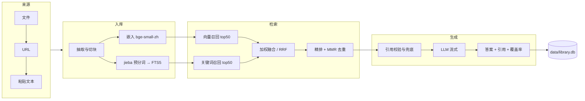

# KnowTune

**本地知识库问答系统。文件进来，答案出去，每句话都带得回原文。**

多格式导入 · 混合检索 · 带引用的流式问答。
数据全部落在本地 SQLite，LLM 接任意 OpenAI 兼容端点（vLLM / LM Studio / Ollama / 云端）。
不联网也能跑，不把你的文档发给任何人。

 

需求覆盖 32 项：24 已落地 / 4 部分 / 4 未做（其中 F5 评测相关 3 项已随评测台迁出，逐条对照与三种统计口径换算见 [docs/ARCHITECTURE.md §14](docs/ARCHITECTURE.md)；此处为「外部承接」口径）。

---

## 它解决什么问题

通用大模型不知道你的东西。把你的资料丢进去，它会读，但读完就开始编——你无从分辨哪句来自你的文档，哪句来自它的训练数据。

KnowTune 的做法是把"猜"变成"查"：

- 你的文件 → 切块 → 建两路索引（向量 + 关键词）
- 提问 → 两路召回 → 融合排序 → 交给模型，但**只让它读这几块**
- 答案里每句结论挂一个 `[1]`，点开就是原文那一段
- 证据不够硬就标出来，或者干脆拒答

这不是 Agent，是一条固定流水线。没有自主循环，没有工具调用，没有"模型自己决定下一步"。**该用工作流的地方硬上 Agent 是负债**，这里不需要。

## 核心能力

| 能力 | 实际做了什么 |
|---|---|
| **导入** | PDF / Word / Excel / PPT / Markdown / 源码 / 网页 URL / 粘贴文本。拖拽即传，超过 8MB 自动分片，中断可续传 |
| **检索** | bge-small-zh 向量（512 维）+ jieba 预分词写入 FTS5，两路各取 50 条，归一化加权融合，前 10 条送 bge-reranker 精排（CPU 约 3 秒，可关） |
| **生成** | 流式输出，只喂检索到的块，强制挂引用编号，越界编号当场剥离 |
| **诚实** | 引用覆盖率（编号在不在）+ **答案支撑度**（逐句与证据块比对，编号指的到底是不是这句话）+ 事实锚点核对 + 低置信标注。宁可说不知道 |
| **可调** | 9 组 50 项参数全部可改，每个知识库一套独立值，改完自动重建索引 |
| **可查** | 两路召回 + RRF 融合 + 精排，每次检索都能在「检索日志」里看到候选与耗时 |
| **多站点** | 一个知识库可以开多个前台问答站（维吾尔语 / 中文 / English），每个站一个端口 |

## 下载与使用

需要 Python 3.11+。下面以 Windows Git Bash 为例，Linux/macOS 把 `.venv/Scripts` 换成 `.venv/bin`。

> **从零 clone 的完整流程见 [docs/RUNBOOK.md](docs/RUNBOOK.md)**（含数据库初始化、密钥、模型目录、实例库绑定、验证清单、排障表）。
> 仓库只包含代码与配置：`data/`（数据库、模型、密钥、语料）、`tools/llama/` 都在 `.gitignore` 里，clone 下来是空壳，必须按 RUNBOOK 生成一遍——**这不是文件漏传**，远端与本地逐文件比对为 95 : 95 完全一致。

### 0. 获取代码

```bash
git clone https://github.com/DLskylife/knowtune.git
cd knowtune
```

或直接在 GitHub 仓库页面下载 ZIP 解压。

### 1. 装

```bash
python -m venv .venv && . .venv/Scripts/activate

# ① 先装 CPU 版 torch：必须走官方 index，直接 pip install 会拉 CUDA 版（体积差 10 倍）
pip install torch --index-url https://download.pytorch.org/whl/cpu

# ② 再装本体（顺序不能反：local extra 里的 sentence-transformers 会带 torch）
pip install -e ".[extract,local]"
```

### 2. 下载模型

嵌入模型与精排模型从 HuggingFace 下载到 `data/models/`，**两个目录名规则不同，别写错**：

```bash
# 国内访问不便时先设镜像：export HF_ENDPOINT=https://hf-mirror.com
mkdir -p data/models

# 嵌入（必需）：目录名【没有】 BAAI-- 前缀，与 default.yaml 的 embedding.local_path 一致
huggingface-cli download BAAI/bge-small-zh-v1.5 --local-dir data/models/bge-small-zh-v1.5

# 精排（默认开启）：目录名【有】 BAAI-- 前缀，程序按 model 里的 / 换成 -- 自动拼
huggingface-cli download BAAI/bge-reranker-base --local-dir data/models/BAAI--bge-reranker-base
```

`rerank.enabled: true` 且 `allow_download: false`：**不下载精排不会联网补，而是每次检索降级到融合分数排名**，能跑但召回质量下降（维医语料 R@5 79.2% → 83.3% 那一截就没了）。所以它是默认链路的一部分，不是可选项。

无 `huggingface-cli` 时：先 `pip install -U huggingface_hub`（新版 CLI 名 `hf download`），或手动从 HuggingFace / ModelScope 下载仓库到对应目录即可。

### 3. 起服务

激活 venv 后直接用 `knowtune` 命令；若没激活，就指 venv 里的可执行文件：

```bash
knowtune serve --port 8000
# 或（未激活 venv 时）：./.venv/Scripts/knowtune.exe serve --port 8000
```

- **端口自定**：本文用 `8000` 举例，本机部署常用 `8013`；其他文档里的 `8765` 等也是示例值，含义相同。
- **首次启动会自动建库**：`config.py` 建 `data/` 目录、`db.conn()` 执行 `schema.sql` 建表并生成 `default` 知识库；也可先跑 `knowtune init` 显式确认。
- 打开 **`http://127.0.0.1:8000`**（Web UI / API 文档 Swagger）。
- **给别的程序调的地址：`http://127.0.0.1:8000/v1`**（OpenAI 兼容）。这是固定入口，不随本地模型实例的端口变化；换模型、换端口、重启实例，外部代码一个字都不用改。支持 `GET /v1/models`、`POST /v1/chat/completions`（含流式）、`POST /v1/completions`。指定后端用 `?provider=<端点名>`、请求头 `X-KnowTune-Provider`，或把 `model` 写成 `端点名::模型名`。启动日志和「模型服务」页的「API 接入」卡片里都有地址与可直接粘贴的 curl。**项目自己也在用这个入口**：预问诊的模型请求、打分台的候选模型都走 `/v1`，主服务没起时各自自动降级到原来的直连路径；维医前台问答站点仍走内部 roles，未改。
- 想让同一局域网调用：主服务用 `knowtune serve --host 0.0.0.0 --port 8000` 启动，并在「模型服务」页勾「启动时允许局域网调用」，卡片会给出局域网地址（无鉴权，别在不可信网络里这么开）。
- **8800 前端不用手动起** —— `config/instances.yaml` 里 `autostart: true`，主服务启动时会自动拉起前台问答站 `http://127.0.0.1:8800`。
- 这是**前台/会话绑定进程**：在 WorkBuddy 里以后台任务跑，会话结束即关；要常驻请另配系统服务（见 [docs/TECH_STACK.md](docs/TECH_STACK.md)）。

### 4. 首次四件事

1. **填密钥**（用云端后端才需要）：进「模型」页，点后端卡片的 ✎，填 API Key，保存即可。**默认就存**——密文落在 `data/secrets.json`，用 Windows DPAPI 加密，绑当前账户与本机，拷走只是一串废数据。下次启动自动恢复，不用重填。想要"只保留这次"就取消勾选「保存到本机」。也可以完全不填：把密钥放进环境变量，端点配置里的 `api_key_env` 指向它就会自动读（优先级：本次填写 > 已保存 > 环境变量）。
2. **建知识库**：「知识库」页 → 新建，选一套预设（通用 / 代码 / 精确 / 空白）作为初始值，`knowtune kb list` 记下它的 id。
3. **绑库**（clone 到新机器必做）：`config/instances.yaml` 里 `kb_id: 2` / `classic_kb_id: 4` 是开发机的库 id，新机器上不存在。改成你自己的 id；没有独立古籍库就把 `classic_kb_id` 填 `0`（退回按标题关键词分栏）。漏了这步的表现是**服务正常、前台侧栏 0 篇文档**。改完在「站点」页点「应用」热生效，详见 [RUNBOOK §6](docs/RUNBOOK.md)。
4. **导文件**：「对话」页把文件拖进窗口，或直接甩到页面任意处。

然后提问。第一次问之前等一会儿——嵌入模型在后台预热，`/api/status` 的 `warmup.state` 变成 `ready` 才算好（冷启实测 93 秒，这期间检索只有关键词一路）。

## 命令速查

```bash
knowtune ingest docs/ARCHITECTURE.md   # 导入文件或整目录
knowtune debug "RRF 权重怎么设"          # 看两路召回与融合排序，不调模型
knowtune ask "RRF 为什么可以不等于 1"    # 单次问答
knowtune serve --port 8000             # Web UI
knowtune status                        # 库、文档、chunk、向量数
knowtune kb list                       # 知识库清单
```

`config/models.yaml` 已预置 `siliconflow` / `deepseek` 两个云端端点与一个 `local` 端点；`local` 里的 `.gguf` 路径是开发机的绝对路径，换机器要改成自己的（或删掉这个后端）。也可以在「模型服务」页新增任意 OpenAI 兼容地址，或用 `python scripts/get_llama.py` 装 `llama-server`、扫本地 `.gguf` 起离线实例（见 [RUNBOOK §3](docs/RUNBOOK.md)）。

## 架构



三类入口共用同一份代码和同一个数据库：

| 入口 | 默认地址 | 谁用 | 代码入口 |
|---|---|---|---|
| 后台管理台 | `127.0.0.1:8000` | 你自己：建库、导入、调参、看日志 | `knowtune.cli serve` → `api/app.py` |
| 前台问答站 | `127.0.0.1:8800` 起 | 终端用户：只能提问 | 后台进程内的一条 uvicorn 线程 |
| 命令行 | — | 批量导入、建库运维 | `cli.py` |

前台不是独立程序，是后台进程里的一条线程（`frontsite/runner.py`）。这样检索器和嵌入模型只加载一次——模型加载是秒级开销，每个站点复制一份等于把内存和冷启动乘上站点数。

**为什么每次查询都跑同一套流程**：检索参数、融合权重都是可测的旋钮，改一个就该能在检索日志里看出候选与耗时的变化。让模型自己决定"要不要再查一次"会把这条因果链打断。

## 界面

五个视图，左栏常驻。首屏不等待任何网络探测——数据来自缓存，探测由前端渲染后二次触发，云 API 连不上也不会白屏。

<details>
<summary><b>首页</b> — 系统资产 / 后端状态 / 运行指标 / 日志</summary>

- **系统资产**：知识库、文档、chunk、向量、磁盘占用、会话，六个数字一眼看完
- **后端服务**：每条后端的探测状态与延迟（就绪 / 端口没起 / 少了 `/v1` / 未配置 / Mock），可单个重探或全部重探
- **探测是两段式**：先打 `/models`，再发一次 1 token 的对话。只有 `/models` 通不算联通（one-api 这类网关永远返回全列表），模型真能出字才算「连通」。结果落盘 `data/probe_cache.json`，重启后仍显示上次结论与探测时间
- **运行状态**：pid、端口、uptime、数据库路径；近 24h 检索次数 / 拒答率 / 平均耗时 / p50
- **日志**：系统日志（环形缓冲 400 条，含建库、导入、探测、后端增删）与检索日志双 tab

</details>

<details>
<summary><b>对话</b> — 导入、提问、引用面板、调试</summary>

- **导入**：文件拖到弹窗、直接甩到页面任意处、填路径（整目录）、网页 URL（可批量）、粘贴文本。超 8MB 走分片上传（4MB 一片，`init → part → finish`），中断可续传，单片失败自动重试两次
- **两段真实进度**：先给字节百分比，字节传完切成后台任务的真实进度——阶段名 + 百分比 + `嵌入 · 48/80 块 · 6s`。批量上传串行、显示"第 2/3 个"，失败逐条列出
- **任务串行、一任务一张卡**：连点三个重索引不会互相顶掉百分比，排队中的那张显示「排队 · 前面还有 2 个」；切到别的页面再回来，仍在跑的任务自动接回卡片
- **Word 按文档流走**：段落、表格、文本框按文件里的顺序进库（表格落成 `列 | 列`），不会整块漏掉；被删除的修订不算正文。旧索引过的文档会打「内容可补全」，重索引一次即可补上
- **会话只有一个**：每个知识库一套上下文，进站接着上次说。侧栏一张会话卡（轮数 + 上下文水位条 + 「刷新对话」）
- **对话配置浮层**：挂载的知识库、生成后端、引用条数、深度检索、调试面板，以及「库参数 / 全局参数 / 模型管理」三个入口。收起时 pill 显示 `知识库 · 后端 · TopK` 摘要。可以不挂知识库直接问，也可以跨全库
- **没配模型会当场拦下**：对话区换成引导卡，按发送也不会发出注定失败的请求。缺配置（没填模型名 / 云端缺密钥）与连不通（端口没起 / 超时）给两种提示
- **引用面板**：对单个 chunk 直接编辑 / 拆分 / 删除，改完立即重算分词与向量
- **诚实信号**：拒答阈值按库标定（留一法，界面显示 `AUC 0.96 · 61 样本`，未标定的库直接写「无有效拒答判定」，绝不拿一个永不触发的数字充数）；证据不硬照答但标「低置信 · 原因 + top 分数」，气泡加虚线左边条。引用侧给两个数：**引用覆盖率**（编号在不在范围内）与 **N% 句有据**（每句话在引用的资料里找不找得到；语义余弦 + 句内事实锚点双重判定，半数锚点落空即不算有据）。覆盖率 < 80% 标黄，越界编号标红，单句连挂 3 个以上编号或嘴上说"没找到"却挂满编号的，标「引用存疑」
- **上下文提示**：历史轮次被截断、或历史吃满预算时，回答上方写明"保留了最近几轮 / 建议刷新会话"；占比超 70% 时回答下方有百分比标记
- **调试面板**：两路召回、融合方式、最终入选、耗时、降级原因、拒答判定（含当前阈值与库覆盖项数）
- **反馈**：每条回答下方「有用 / 无用」，无用可填原因，进待分析队列

</details>

<details>
<summary><b>知识库</b> — 每库一套参数、检索面板、完整性自检</summary>

- **选中即看**：点左侧某个库，右区直接给参数快照、文档列表、会话列表
- **每库独立参数**：25 项，改全局不影响它，改它也只影响它——没有「覆盖 / 跟随全局」这个维度（那套设计要在每行多放一个开关，24 行就长得没法扫）。分组默认折叠，**组标题上直接显示当前值**；数值项用 `− 数字框 ＋`（按 step 精确走）+ 默认 / 下限 / 上限 chip——拒答阈值差 0.05 就是"拒答"和"硬答"的分界
- **改完自动重排**：带「重建」标记的分块参数保存后，自动重建本库全部文档的索引，一张进度卡显示「重建第 2/5 篇 · 嵌入 64/162 块」。检索类参数保存即生效
- **分块策略**：按长度打包 / 按章节切 / 按段落切
- **检索面板**：输入一句话，三列并排（最终入选 / 稠密召回 50 / 稀疏召回 50），每条带排名、分数、文档名、章节路径和前几行原文。不调生成模型，通常几十毫秒
- **文档预览**：按切分顺序列出每个块（token / 字符数 / 页码 / 章节路径），每块可复制原文。顶部「已加载 M / 共 N 块」+「再加载 500 块」——分批加载而不是静默截断
- **完整性自检**：重新抽取源文件，逐窗口核对是否进了当前代次的 chunk，给出覆盖率与成段缺口原文（≥60 字才算证据）。源文件导入后被改过时单独提示"库里是上一版"
- **建库向导**：名称、描述、四套预设、块长 / 重叠 / Top-K / 后端。预设只在建库时套一次，不碰拒答阈值——那是嵌入模型分布的属性，必须标定

</details>

<details>
<summary><b>模型</b> — 两类端点、本地实例、固定 API 入口、提示词</summary>

- **只有两类端点**：`local`（本机能起，模型带 `.gguf` 路径和端口）与 `openai`（任何兼容 `/v1` 的地址）。预置的云端配置全部删掉了，要接云端自己填地址 + 密钥
- **本地实例**：「扫描本地模型」找 `.gguf` → 加进端点 → 卡片上「启动 / 停止」直接拉起 llama-server。端口写回配置后固定，被别的进程占了会明确报错而不是悄悄换口
- **固定 API 入口**：`http://127.0.0.1:8000/v1`，转发给当前端点；外部程序写死它即可。实例直连地址（`http://127.0.0.1:8090/v1` 之类）也在卡片上，少一跳但会随端口变化
- **模型目录是跨后端的**：下拉里平铺全部端点加全部模型（按端点分组），选哪个就测哪个，也能手动输入模型名
- **当前使用是两段**：端点 + 模型（`端点::模型`）。设了就落盘，重启后仍是它；缺密钥时卡片直接写「缺密钥：点编辑填 API Key」
- **测试联通**：点 ⟳ 真发一次最小请求，返回状态 + 延迟 + 模型数。成功只说「已连通」，失败说清是"端口没起""少了 `/v1`"还是"模型名不在列表里"
- **编辑 = 弹窗**：名字可改（改名会连带迁移 active 与旧条目），弹窗里能先探测再把模型列表渲染成可点的 chip
- **提示词**（卡片 →「提示词」）：生成与翻译两个角色，三层覆盖（本后端专属 → 角色默认 → 内置默认）。改回原样等于没改；内置文件只读，覆盖只写 `config/prompts.yaml`；每次保存前自动快照，留 30 份可回滚；预览按当前草稿渲染模型真正收到的东西

</details>

<details>
<summary><b>站点</b> — 前台问答站（维吾尔语 / 中文 / English）</summary>

每个实例 = 一个知识库 + 一个端口 + 一套语言，在「站点」页新建与启停（`config/instances.yaml`）：

| 项 | 说明 |
|---|---|
| 端口 | 8800–8899（避开后台 8000 与 vLLM 8100），自动挑空闲的 |
| 语言 | 维吾尔语（RTL）/ 中文 / English，决定界面文案与回答语言 |
| 语料语言 | 中文语料 + 维语提问 = 先把问题译成中文再检索；导维语语料时改成「维吾尔语」可跳过翻译 |
| 答案方式 | `中文成稿后翻译`（默认，质量稳）/ `直出`（快，小模型容易跑偏） |
| 开机自启 | 随后台一起拉起 |

维吾尔语问答的质量上限由模型决定：`qwen2.5-7b` 这一档能吐阿拉伯字母但语义不通、容易复读（系统会截断并标注），换 14B/32B 或维吾尔语能力更强的模型才真正可用。实例启动时做一次维吾尔语能力自检，结论显示在卡片上；答案下方保留中文原稿，方便分清是"检索错了"还是"翻译错了"。

</details>

## 参数

优先级从高到低：

```
知识库覆盖（kb.config_json，按库）
  > 运行时覆盖（参数面板）
    > config/local.yaml
      > config/default.yaml
```

`default.yaml` 永远只读——里面的注释（为什么是 480 不是 512）是这个项目最贵的资产，程序回写一次就没了。`local.yaml` 只记录与出厂值不同的项；`kb.config_json` 存的是**一整套完整值**，每个库建库时复制一份独立参数。

**嵌入模型不可按库覆盖**：向量矩阵按 `模型@维度` 建，整个进程只驻留一个 embedder，界面上如实写「跟随系统」。

<details>
<summary><b>9 组 46 项可调参数</b></summary>

| 组 | 项数 | 关键项 |
|---|---|---|
| 召回 | 4 | 两路召回开关与候选数 |
| 融合 | 10 | 融合方式、RRF k、两路权重、融合候选数、邻块扩展（半径/折扣/种子数/上限） |
| 精排与去重 | 8 | 精排开关与模型、最终条数、超时、batch、截断长度、MMR |
| 拒答与分档 | 7 | min_score / min_margin、margin 窗口、低置信提醒、证据中档比例 |
| 生成 | 6 | 后端、温度、最大输出、上下文预算、资料保底长度、关闭思考链 |
| 分块 | 5 | 策略、长度、重叠、最小块、标题对齐 |
| 会话 | 2 | 历史轮数、历史占用上限 |
| 导入 | 2 | 单文件上限、PDF 文本层下限 |

判断标准是"改了会不会影响答案质量或延迟"。纯实现细节（状态码、预览截断字符）不进注册表——46 项里混进没意义的旋钮，等于把这张表变成噪音。

</details>

## 已知限制

这一章记录的是**方法与资产边界**，不是待办清单：下面的数字都是实测量出来的能力上限，改文档不会让它们消失，把它们从文档里删掉只会让下一个人重新踩一遍。项目里几份清单分工不同，别混着读：

- **本章**：工程与资产边界（模型、标定、鉴权、未做的 P2 需求）
- [USER_GUIDE §9](docs/USER_GUIDE.md)：提问时撞上的使用侧现象（短泛问题、古籍注解、引用条数等）
- [ARCHITECTURE §14](docs/ARCHITECTURE.md)：需求逐项状态、⚠️/⬜/↗ 与三种统计口径
- [RUNBOOK](docs/RUNBOOK.md)：从零部署、跑通判据与排障
- [WBS.html](docs/WBS.html)：交付时的工作包与范围缺口快照（带 2026-11-07 状态更新）

各条已按当前代码与配置校订：精排状态、`model-eval` 归属、§14 口径，以及 `USER_GUIDE §9` / `WBS.html` 里「精排没有缓存 / 精排模型未下载 / 无逐句判据」等已失效条目，均已同步。

- **精排当前开启**（`BAAI/bge-reranker-base`，本地权重 1.1 GB 已就位），不再走降级。降级只在两种情况发生：本地模型目录缺失（`allow_download: false`，不会联网补下），或单次精排超过 8 秒（记 `degraded=rerank_timeout`）。补下命令见上文「2. 下载模型」。**这是延迟与质量的取舍，不是配置疏漏**：实测精排把 R@5 从 79.2% 提到 83.3%，代价是 19ms → 7.5s；候选池缩到 12 条时精排反而跌到 75%（该模型在现代汉语上训练，对「白话问、文言答」的判定不稳）。开关是 `retrieval.rerank.enabled`，实测表见 `docs/ARCHITECTURE.md` §12.45
- **嵌入模型冷启 93 秒**（实测，16 核），期间检索只有 BM25 一路。之后编码约 21 chunk/s
- **本地 7B 一次完整回答实测 222 秒**。SSE 流式已经有了，但检索完到首 token 之间仍是静默期，界面用流式光标 + 计时兜住"没反应"的观感。真正的解法是换更快的后端
- **拒答阈值已按库标定，但仍是粗筛**。用留一法（屏蔽一篇文档、拿它的专属问题去问）在维医库上造出 61 组正负例：**AUC 0.959**，阈值 **0.692**，误拒 4.9%、漏拒 23%。数字比过去的 0.35 实在得多，但 23% 的漏拒说明它只能当第一道筛子——真正的拦截在生成后的支撑度。阈值的适用边界也要说清：探针问的是"白病的临床表现有哪些"这类**带文档核心名**的问题，真实用户问"身上长白斑是什么病"分数会更低，可能会被误拒。每条探针的分数与判定都留在标定文件里，可以自己复核
- **引用覆盖率是形式指标，已补「答案支撑度」**。覆盖率只证明编号在范围内，不证明编号指的那段在说这句话——"覆盖率 100% + 整段胡说"可以同时成立。支撑度把答案逐句与所引证据块算余弦，外加事实锚点比对（剂量、型号、版本号、命令行是否出现在证据原文）
- **支撑度的实际能力边界**（标定量出来的，不是猜的）：
  - 判「有没有依据」很准：同块句子 vs 异文档句子的 **AUC 0.992**，阈值 0.665，两边误判都 4.3%
  - 判「事实对不对」几乎无效：同一块里把 `300ml` 改成 `700ml`，余弦基本不动，**AUC 0.514 = 抛硬币**。这一层只靠锚点兜，锚点表覆盖了 84% 的篡改
  - 锚点参与的是**句级否决**：一句话里半数以上锚点在证据中找不到，这句就不算"有据"。没有这条，术语堆砌能把整段编造的 `grounded` 顶到 0.75
  - 仍是句级判定，一句话里半真半假（前半句有据、后半句编且不带数字）抓不出来
- **标定要对着跑起来的服务做**（`model-eval/calibrate.py`），换语料或换嵌入模型都得重跑。模型指纹对不上时标定文件自动失效，退回粗筛。该工具已随评测台拆为独立项目 `model-eval`，不在本仓库内；主项目只读它产出的 `data/calibration/kb_<id>.json`
- **融合权重是在维医语料上实测出来的**（两套探针 × 两个种子 × n≈300）。换一批文档，BM25 与向量的强弱关系可能反转，用同一把尺子重跑再定 `retrieval.fusion.*`
- **未做**（均为 P2）：查询改写 F2.5、对话内指代改写 F4.3、跨会话历史检索 F4.4。另有 sitemap 整站抓取未完成，但它属于 F1.2 URL 导入的**部分落地**项，不是独立需求条目；逐条状态与三种统计口径见 `docs/ARCHITECTURE.md` §14
- **后台没有鉴权**。默认只监听 `127.0.0.1`，别直接暴露到公网。这是单机本地工具的既定取舍，不是漏做：加鉴权要同时改 API 层、前台站点、预问诊引擎与 `/v1` 网关的调用方，属于功能变更；在只监听回环地址的前提下，外部暴露面本就不存在。要上公网必须先补这一层。

## 项目结构

```
src/knowtune/      全部 Python 源码 + 两套前端静态文件
  ingest/          抽取、切块、分片上传
  index/           嵌入、向量矩阵、FTS5
  retrieve/        两路召回、融合、精排、MMR
  generate/        prompt 组装、LLM 客户端、引用校验、证据分档
  api/             后台 8000 的 FastAPI + 静态页
  frontsite/       前台问答站（同进程线程）
config/            default / local / models / instances / prompts
data/              library.db、上传原件、模型权重、密钥
docs/              架构文档、项目地图、WBS
```

> 模型评测台已拆分为独立项目 `model-eval`：它要 Gradio 6，和本项目的
> fastapi/uvicorn 依赖组合对不上，混在一个 venv 里必然打架。本项目只负责检索与问答。

## 文档

| 文件 | 内容 |
|---|---|
| [docs/RUNBOOK.md](docs/RUNBOOK.md) | **完整运行说明**：从零 clone 到三板块可用，含仓库内容清单、依赖顺序、模型路径、初始化、实例库绑定、验证清单与排障 |
| [docs/USER_GUIDE.md](docs/USER_GUIDE.md) | **使用说明书**：跑起来、建库导入、怎么读引用与支撑度、参数含义、标定步骤、排障表、已知限制 |
| [docs/PROJECT_MAP.md](docs/PROJECT_MAP.md) | 每个目录每个文件干什么，五层依赖怎么拼起来，两条主链路的时序 |
| [docs/ARCHITECTURE.md](docs/ARCHITECTURE.md) | 数据模型、检索参数为什么这么定、拒答标定、实测数据、踩坑记录 |
| [docs/TECH_STACK.md](docs/TECH_STACK.md) | 完整技术清单、分层架构、三处关键决策（无向量库 / Bi+Cross 两阶段 / 中文 BM25 预分词） |
| [docs/WBS.html](docs/WBS.html) | 8 个交付物 / 49 个工作包 / 9 项范围缺口的**交付时快照**（带 2026-11-07 状态更新；现行逐项状态以 §14 为准） |
| [config/default.yaml](config/default.yaml) | 全部可调参数，每个默认值都写了为什么 |

环境要求见上方「装」一节，从零部署的完整步骤见 [docs/RUNBOOK.md](docs/RUNBOOK.md)；交付清单见 [docs/WBS.html](docs/WBS.html)。

## 许可

MIT
