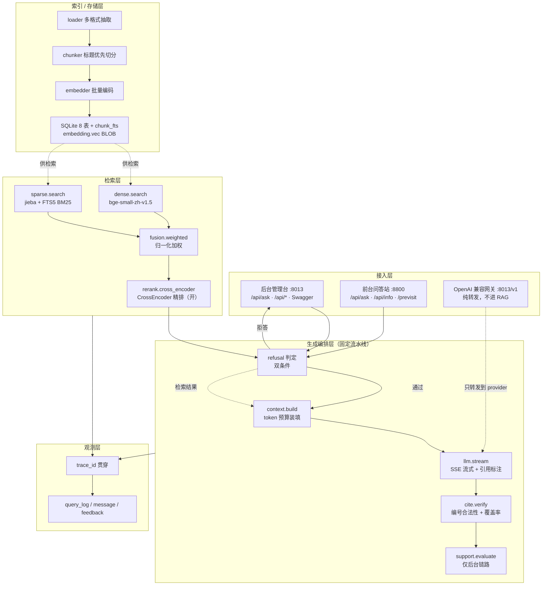

# KnowTune — 架构设计（现行实现）

> **事实基线日期：2026-11-07。** 本文所有数字、状态、路径、优先级均以这一天的源码、配置、SQLite 与运行态实测为准。
> **本文只描述现行实现；历史决策、实现期踩坑与变更日志见附录 A「实现期记录（历史归档）」。**
> 文档定位：现行架构、数据模型、检索/生成链、关键决策与实测数据、需求对照、代码已知不一致、历史归档。操作与部署步骤不在这里，见 [RUNBOOK.md](RUNBOOK.md)。

术语约定（英文键名首次出现附中文说明）：主服务 / 后台管理台（`8013`，README 示例写 `8000`）；前台问答站（`8800`）；知识库 kb（维医 #2、临床药理 #3、古籍 #4）；板块 section（`med` 维医问答、`classic` 古籍问答、`pv` 预问诊）；后端 provider（`siliconflow` / `local` / `deepseek`）；角色 role（`translate` / `generate` / `copy_ug` / `copy_zh`）；精排 rerank、拒答 refusal、支撑度 support、降级标记 degraded、标定 calibration。

---

## 0. 先说结论：这不是 Agent，是固定流水线

按需求特征先做判定，不给「智能体」这种含糊标签：

| 判定项 | 实际情况 | 结论 |
|---|---|---|
| 步骤是否固定 | 导入 → 分块 → 嵌入 → 双路召回 → 加权融合 → 精排 → 装填 → 生成 → 引用校验 → 支撑度，全程无「看中间结果再决定下一步」 | 固定 |
| 分支能否穷举 | 只有精排、MMR、拒答、邻块扩展、查询改写这几个布尔开关 | 能穷举 |
| 是否需要模型决定调用什么工具 | 不需要。模型只做两件事：把问题变成向量、把上下文变成答案 | 不需要 |
| 查法是否固定 | 检索路径完全确定：dense + sparse 双路，加权融合后送精排 | 固定 |

**判定：这是 Prompt Chaining（提示链）+ 局部 Routing（开关路由），不是 Agent。** 不许包装成 Agent 卖。

工程含义，正面说清：

- 不需要 `max_steps` / 循环预算 / 人工接管点那一套自主循环护栏——没有循环就没有失控风险。这是优势，不是缺陷。
- 需要的是**流水线级护栏**：每段超时、每段降级、可回放、可评测。RAG 翻车大多不在「模型太笨」，而在「第 3 段的降级把第 2 段的结果悄悄吃了」，所以每一段都要打 `degraded`（降级标记）。
- 唯一带不确定性的是 F2.5 查询改写与 F4.3 指代消解，它们是**可开关的单次 LLM 调用节点**，不是决策节点，且当前均未启用（见 §4、§13）。

**什么时候才该升级成 Agent**（写在这里是防止未来无意识越界）：当出现「根据检回结果决定要不要再检索一轮 / 换一个知识库再查 / 调用外部工具核实数字」这类需求时，才需要 Evaluator-Optimizer 或 Autonomous Loop，届时必须补齐步数上限、预算、墙钟、人工接管四件套。当前明确不做。

---

## 1. 需求锚定与成功指标

### 1.1 五要素

| 要素 | 内容 |
|---|---|
| 目标 | 在单机 CPU 上跑通「导进来 → 查得准 → 答得出且有据 → 改坏了能测出来」的闭环 |
| 输入 | 本地文件（PDF / MD / TXT / DOCX / XLSX / PPTX / 源码）、单条或批量 URL、目录；用户自然语言提问 |
| 输出 | 带 `[n]` 引用的回答（可回查 chunk）、拒答说明、检索调试视图、可检索日志 |
| 约束 | 数据不出本地；CPU 优先；单机单用户；LLM 只走 OpenAI 兼容协议；不预留多租户 |
| 风险 | 精排在 CPU 上是延迟大头；中文 FTS5 默认分词失效；拒答阈值靠拍脑袋会两头挨打；分块策略对召回的影响远大于模型选择 |

### 1.2 成功指标（按现行实现校正）

| 指标 | 定义 | 通过线 / 现状 |
|---|---|---|
| Recall@5 | 期望来源是否落在最终 Top-5 | 设计线 ≥ 70%。现行维医语料实测见 §11：切窗编码无精排 79.2%、精排 83.3%（条件见 §11），达标 |
| MRR | 期望来源首次出现排名的倒数 | 观测项，不做门禁 |
| 引用正确率 | 抽检 10 题的引用是否正确 | 设计线 ≥ 80%，由 `cite.verify` 与人工抽检共同支撑 |
| 检索延迟 | 含精排 / 不含精排 | 设计线含精排 P95 ≤ 4s、不含 ≤ 300ms。现行精排 `10 × 384` 实测 3.07s（§11 条件）落在线内 |
| 改参数后出评估差值 | 改检索参数后回归对比 | 设计约束「5 分钟内出差值」。**校正**：评估台已迁出为独立项目 `model-eval`，本仓库不自带评估集与跑分命令（见 §7、§13），该指标现由外部项目承担 |
| 单次问答成本 | `prompt_tokens × 单价 + completion_tokens × 单价` | 只计量不设限；`query_log` 已记两段 token 与模型名 |

### 1.3 现行环境基线

- Python ≥ 3.11，FastAPI + uvicorn，SQLite（WAL），numpy 暴力向量检索，jieba + FTS5 稀疏检索。
- `pyproject.toml`：`name=knowtune`、`version=0.1.0`、MIT，入口 `knowtune = knowtune.cli:main`，wheel 打包 `src/knowtune` 与 `src/previsit`。
- 依赖分组：`extract`（PDF/Word/Excel/PPT/URL）、`local`（sentence-transformers）、`onnx`（可选，未启用）、`dev`（pytest/ruff/mypy）。
- **CPU 版 torch 必须先装**：先 `pip install torch --index-url https://download.pytorch.org/whl/cpu`，再 `pip install -e ".[local]"`。顺序反了会拉 CUDA 版，体积差一个数量级。
- 本机实测前提：16 核 CPU / 无 GPU。所有性能数字都带这个前提，换机器不能照搬。

---

## 2. 总体架构

### 2.1 分层图



### 2.2 进程、端口与入口

| 项 | 值 |
|---|---|
| 后台主服务 | `knowtune serve --port 8013`（`cli.py` 默认 `8000`，绑 `127.0.0.1`） |
| 后台 Web UI + Swagger | `http://127.0.0.1:8013/` |
| OpenAI 兼容网关 | `http://127.0.0.1:8013/v1` |
| 前台问答站 | `http://127.0.0.1:8800/`，`instances.yaml` 的 `port` + `autostart: true`，**主服务进程内 daemon 线程**，不另起进程 |
| 前台端口范围 | 8800–8899（`instcfg.py` 的 `PORT_MIN/MAX`） |
| 预问诊 | 挂在前台 `/previsit`，对外全路径 `/previsit/api/previsit/*`；**没有独立站点** |
| `KNOWTUNE_GATEWAY` | `cli.py:234` 按实际 `--port` 写入，供预问诊 LLM 网关使用 |

启动链：`cli.main` → `cmd_serve`（写 `KNOWTUNE_GATEWAY` → `uvicorn.run("knowtune.api.app:app")`）→ 模块导入期构造 `AppState`（配置 / DB / Embedder / VectorStore / SparseIndex / Reranker / RetrievalEngine / IngestPipeline / LLMClient + `InstanceManager`）→ `lifespan`（密钥 attach、预热线程、`sites.start_autostart()`）→ `runner.start()` 起前台线程。

### 2.3 `/v1` 是纯转发网关，不是 RAG 入口

`/v1/chat/completions`（`api/app.py:1271-1303`）只把请求原样转发到选中的 OpenAI 兼容后端：转发 body、透传 stream（`aiter_raw` 逐块透传，不解析不缓冲）、响应带 `X-KnowTune-Upstream` 标明实际端点。**它不经过任何检索、精排、装填、引用校验。** 它的用途是给预问诊、外部脚本、第三方 OpenAI 客户端一个「写死不变」的地址。

**RAG 入口只有两个**：后台 `/api/ask` 与前台 `/api/ask`。把 `/v1` 当成问答入口是常见误读，等于把「能聊天」误当「能检索知识库」。

### 2.4 两套 previsit 的关系（不是两套预问诊）

- `src/previsit/`：实现**真身**，v0.3.0，零 `knowtune` 依赖，可独立部署。
- `src/knowtune/previsit/`：**桥接层**，五个同名文件纯再导出 + `app.py` 装配层（注入进程内检索器、LLM 适配器、建 FastAPI app）。

运行时实际跑的是 `src/previsit/` 的代码，由 `frontsite/site.py:331-336` 挂到 `/previsit`，并用 `_SectionGate` 按 `pv` 板块开关做 404 拦截。**这是「一份实现 + 一层装配」，不是重复实现，不要写成「两套预问诊」。**

### 2.5 现行目录

```
src/knowtune/            主项目
  cli.py                 命令入口、注入 KNOWTUNE_GATEWAY
  config.py              配置加载、按库标定、模型指纹校验
  kbconfig.py            库级参数全量快照 + 出厂基线比对
  db.py / schema.sql     SQLite（8 表 + 1 FTS5 虚表）
  secrets.py             Windows DPAPI 密钥
  roles.py               后端/角色解析
  promptcfg.py           提示词覆盖层（provider / scope）
  modelcfg.py / settings.py / services.py / localmodels.py
  ingest/                loader / cleaner / chunker / pipeline
  index/                 embedder / vectors / sparse
  retrieve/              engine（双路召回、融合、拒答判定）/ rerank（精排 + MMR）
  generate/              prompt / llm / cite / evidence / support / think
  api/app.py             后台全部 HTTP 接口（约 4400 行），唯一大文件
  api/static/            后台前端：index.html / app.js / style.css，构建号 0.9.54
  frontsite/             instcfg / runner / site
    static/              前台前端：index.html / app.js / style.css
  previsit/app.py        主项目装配层（注入进程内检索器、LLM 适配器、建 FastAPI app）
src/previsit/            预问诊独立实现（v0.3.0），零 knowtune 依赖
  app / engine / config / llm / retriever / kb / kgdb / store / settings
config/                   default / local / models / instances / prompts(.yaml) / prompts/*.md
                          previsit.yaml / previsit.overrides.yaml / previsit_kb.yaml
data/                    不进版本库：library.db、uploads/、models/、calibration/、secrets.json
docs/                    7 份文档
scripts/                  fake_llm.py / get_llama.py / shot_models.py
```

---

## 3. 数据存储设计

单文件 SQLite（WAL）+ 向量存在库内 BLOB。理由见 §8.1 与本节 3.2。

### 3.1 八张实体表 + 一张 FTS5 虚表

现行 `schema.sql` 建 8 张实体表和 1 张 FTS5 虚表，另有 FTS5 自动维护的 5 张影子表：

| 表 | 职责 | 关键字段 |
|---|---|---|
| `kb` | 知识库 | `id`、`name`、`description`、`config_json`（库级参数全量快照） |
| `document` | 文档 | `kb_id`、`source_type`、`source_uri`、`content_hash`、`status`、`n_chunks`、**`active_gen`**、`fail_reason` |
| `chunk` | 分块 | `doc_id`、`generation`、`seq`、`text`、**`text_seg`**（jieba 预分词，供 FTS5）、`token_count`、`heading_path`、`content_hash`、`is_hidden` |
| `embedding` | 向量缓存 | `content_hash` + `model` 主键、`dim`、**`vec BLOB`**（float32 little-endian） |
| `session` | 会话 | `id`(uuid4)、`kb_id`、`title`、`updated_at` |
| `message` | 消息 | `session_id`、`role`、`content`、`trace_id`、`citations_json` |
| `query_log` | 请求日志 | 见 §7.3 |
| `feedback` | 反馈 | `message_id` 主键、`verdict`(up/down)、`comment` |
| `chunk_fts` | FTS5 虚表 | `text_seg`，`tokenize='unicode61 remove_diacritics 2'`，rowid 与 `chunk.id` 对齐 |

`chunk` 上有 `idx_chunk_doc_gen(doc_id, generation)` 与 `idx_chunk_hash(content_hash)` 两个索引。

**采集时行数（2026-11-07，`data/library.db`）**：`chunk` 28020、`document` 32、`embedding` 28552、`kb` 3、`session` 18、`message` 54、`query_log` 110、`feedback` 2。3 个知识库、32 篇文档全部 `ready`、28020 个 chunk、28020 条 512 维向量。`embedding` 比 `chunk` 多，是按 `content_hash` 跨文档 / 跨代次复用向量的结果，不是脏数据。

**两种统计口径不矛盾**：前台 `/api/info` 报 `docs=31 / chunks=1442` 是**站点绑定库（kb2 + kb4）的口径**；后台全局是 32 / 28020。差额主要来自 kb3（临床药理）不属于该站点。写状态栏时必须带「哪个口径」，否则会出现「文档数对不上」的假故障。

### 3.2 向量存 BLOB，而不是单文件

初版曾设计 `data/vectors/{kb_id}.f32` 单文件 + `np.memmap` 零拷贝。实现时改为把向量放进 `embedding.vec` 的 BLOB 字段，与 chunk 同库、同事务。判断依据是**一致性优先**，不是性能：

- 两处存储意味着「重新索引成功但向量文件没写完」这类故障需要人工比对排查，而 WAL 单事务天然没有这个窗口；
- 省下的那 200MB 对 16GB 机器毫无意义；
- `np.memmap` 的零拷贝在单用户场景没有实际收益：一次加载 196MB 只要 < 100ms，进程活一天也就这一次。

加载方式：首次检索时从 DB 建一次内存矩阵并常驻，导入完成后 `invalidate()` 重建。规模上限假设 ≤ 10 万 chunk（10 万 × 512 维 × float32 ≈ 196 MB，一次 `matrix @ q` 约 7.2ms / 16 核）。在这个量级 Chroma / Qdrant / FAISS 全是负资产：多一个进程、多一套依赖、多一次序列化，换来本不需要的 ANN 索引。**切换点按 chunk 数定、不按耗时定**：超过 20 万条才考虑 `sqlite-vec`，因为先撞墙的是内存（50 万条约 977MB），不是算力。

### 3.3 代次 `active_gen` 原子切换（F1.7）

重新索引不是「原地改」，是「另写一代再切换」：

1. 新代次 `generation = old + 1` 的 chunk 与向量**全部写完**；
2. 在**一个事务内**更新 `document.active_gen = new_gen`；
3. 旧代次数据保留 1 个版本供回滚，其余在下次清理时删除。

检索 SQL 恒定带 `c.generation = d.active_gen` 条件，杜绝「新旧索引混检」。任一阶段失败则旧代次仍生效，文档 `status=failed` + 可读 `fail_reason`，不会出现「索引写到一半」的可见状态。文档状态机：`pending → indexing → ready / failed`，文件哈希变化触发 `stale → indexing`。

### 3.4 库级参数：全量快照 `__full__` 与「手动改过」判据

`kb.config_json` 存的是**一整套完整值**（`kbconfig.py` 以 `__full__` 标记），不是「与全局不同的差异项」。建库时按预设复制一整套独立值，之后全局与本库互不影响。

这直接决定了「用户手动改过」的判据：**与出厂基线值不同**，而不是「键存在」（`api/app.py:542-543`）。因为全量快照下每个键都存在，若按「键存在」判断，会得出「所有库都手调过」，导致按库标定永不生效。同一条坑在拒答阈值上踩过一次。

允许按库覆盖的参数只有「同一问题在不同库里答案不同」的那些：分块、召回宽度、融合权重、精排条数、拒答阈值、生成后端与温度、历史轮数。**嵌入模型故意不在内**：向量矩阵按 `模型@维度` 建，整个进程只驻留一个 embedder；允许按库换模型就得载多份权重、按库分表、给每个库单独标定，代价远大于收益，界面如实写「跟随系统」。

### 3.5 密钥：Windows DPAPI

后端注册表在 `config/models.yaml`，**密钥不写进它**。密钥由管理员在界面填写，存 `data/secrets.json`，Windows DPAPI 密文，**绑当前账户 + 本机**——换账户、换机器解不开，文件拷出去只是废数据。无系统级加密的平台直接拒绝落盘并如实报错，不拿自造的「加密」糊弄。

- 默认「填了就存」；显式取消勾选「保存到本机」，意图记进空文件 `secrets.off`，重启后仍生效；`api_key_env` 指向的环境变量是优先级最低的第三来源。
- 模型页「清空密钥」→ `POST /api/models/keys/clear`，内存与文件一起清。
- 键是**后端名**不是模型名：同一个后端换模型不该让密钥失效。
- `_inline_key` 是 pydantic `PrivateAttr`，`model_dump()` / YAML 回写都拿不到它，密钥绝不进序列化结果。

---

## 4. 检索层（质量天花板）

### 4.1 现行参数（`config/default.yaml` 现值）

| 参数 | 值 | 说明 |
|---|---|---|
| `chunking.size / overlap` | 480 / 80 | 标题优先，`min_chunk` 80 |
| `retrieval.dense.top_k / sparse.top_k` | 50 / 50 | jieba 预分词 + FTS5 unicode61 |
| `fusion.method` | **`weighted`** | `w_dense 0.35 / w_sparse 0.50 / w_third 0`；RRF 参数 `k=60` 保留但**不启用** |
| `fusion.top_k` | 10 | 送精排的候选数，CPU 延迟的主要开关 |
| `rerank.top_k / max_length / batch_size / timeout_s` | 5 / 384 / 32 / 8.0 | 超时打 `rerank_timeout` |
| `mmr.enabled` / `expand.enabled` / `query_rewrite.enabled` | false / false / false | 三者均未启用 |
| `refusal.min_score / min_margin` | 0.35 / 0.0 | 出厂值；按库标定可覆盖（见 §5.4） |
| `generation.temperature / max_tokens / context_token_budget` | 0.3 / 3072 / 6000 | `disable_thinking: true`，SSE 流式 |
| `chat.history_turns / history_token_budget` | 5 / 1500 | |

### 4.2 中文 FTS5 必须预分词（实测）

SQLite FTS5 的默认 `unicode61` 对中文不分词，整句会被当成一个 token。本机实测（Python 3.13 / SQLite 3.53.1）：

| 方案 | 2 字查询（「混合」「检索」「分块」） | 结论 |
|---|---|---|
| 默认 `unicode61`，入库原文 | 全部 0 命中 | 中文完全检索不到 |
| `trigram`，入库原文 | 2 字词全灭（trigram 要求查询 ≥ 3 字符） | 不可用作主方案 |
| `unicode61` + **jieba 预分词**（空格分隔） | 全中 | **采用** |

两个配套细节：

- `bm25(chunk_fts)` 返回**负数、越小越相关**，排序必须 `ORDER BY bm25(...) ASC`；高频无区分度词 IDF≈0、分数趋近 `-0.0`。这正是加权融合要先做 min-max 归一（且先翻符号）的原因——两路分数量纲不一致，不能直接用原始分数相加。
- 入库和查询必须用**同一份 jieba 词典**；专有名词（RRF、bge、chunk）会被切碎，靠用户词典兜。

### 4.3 加权融合 vs RRF（n≈300 条件）

现行是**归一化加权融合**，不是 RRF。这不是口味问题，是量出来的结论。当时用两套探针（`verbatim` 逐字子串 / `kw` 取短实词）× 两个随机种子 × n≈300 测 R@5 / MRR：

| 配置 | verbatim R@5 | kw R@5 |
|---|---|---|
| 仅 BM25 | 0.98 | 0.96 |
| 仅稠密（bge-small-zh） | 0.58 | 0.45 |
| 融合 RRF(0.5/0.35) | 0.75 | 0.63 |

融合比其中较强的一路还差 0.23：RRF 只认名次，`1/(k+rank)` 把「BM25 断崖式第一」和「险胜第二」压成只差一个名次，稠密路那批「语义沾边但不对」的候选靠名次把决定性命中挤了下去——**分差信息被 RRF 丢掉了**。

改成 `weighted`（两路分数各自 min-max 归一到 0~1 再按权重相加）后：

| 配置 | verbatim R@5 / MRR | kw R@5 / MRR |
|---|---|---|
| RRF(0.5/0.35) | 0.74~0.76 / 0.64 | 0.63 / 0.53 |
| **weighted(0.35/0.50) — 现行** | **0.96~0.97 / 0.92~0.94** | **0.96~0.97 / 0.89** |

两个必须记住的坑：bm25 返回负值、越小越相关，**归一化必须先翻符号**，漏了加权融合的 R@5 会掉到 0.32，比 RRF 还差一半；`_norm` 里分数全持平时要退化成 0.5，不能除零。权重写成 0.35 / 0.50 表达的是**相对比例**（`w_dense : w_sparse`），不要求和为 1；`w_third` 默认 0，第三路启用时强制三者归一。

**这些数字是在维医语料上量出来的，换一批文档（比如代码库）BM25 与向量的强弱关系可能反转**，所以给可调项 + 一把能复跑的尺子，不给死值。

### 4.4 精排的 CPU 代价与参数扫描

交叉编码器的浮点量约 `2 × 参数量 × (query + doc) token 数`。`BAAI/bge-reranker-base` 约 278M 参数，本地权重 `data/models/BAAI--bge-reranker-base`（约 1.1 GB，目录名带 `BAAI--` 前缀，由 `model` 里的 `/` 替换而来），`allow_download: false`——缺失只降级、不联网补。**三个知识库的 `retrieval.rerank.enabled` 均为 `true`，`/api/status` 报 `rerank.enabled=true, last_error=null`，精排实际在跑。**

参数扫描（`model-eval/scan_rerank.py`，维医库 22 道口语题；**该工具已随评测台迁出为独立项目 `model-eval`，本仓库不自带**）：

| 候选 × 截断 | 延迟 | doc 级 top1 | MRR | 备注 |
|---|---|---|---|---|
| 不精排 | 0.09 s | 0.591 | 0.691 | 基线 |
| 20 × 512 | 8.16 s | 0.636 | 0.750 | 出厂旧值，最慢且最差 |
| **10 × 384** | **3.07 s** | **0.727** | **0.807** | **现行值** |
| 10 × 128 | 1.08 s | 0.773 | 0.822 | 分数最高，但只看标题首段，未采用 |

三条反直觉结论：

1. **截断越短，分数越高。** 512 是拐点，块平均较长，长窗口把 OCR 噪声、无关段落一并算进相关性；短窗口只看开头（小标题 + 定义）反而命中主题。128 那档分数最高，但答案落在块中段就排不出来，指标测不出这种伤。**取 384：没有这个隐患的最短一档。**
2. **候选 10 是拐点，不是省出来的。** 8 条时 top1 从 0.727 掉到 0.682，第 9–10 名里确实有答案；20 条不比 10 条好，只是慢一倍。
3. **收益是真的，但不是「更聪明」，是「更会排」。** 精排把 R@5 从 79.2% 提到 83.3%（维医语料），代价 19ms → 7.5s；候选池缩到 12 条时反跌到 75%。它主要把已经召回到的正确块从第 6–10 位提上来。

决策：默认开，`fusion.top_k: 10` + `rerank.max_length: 384` + `batch_size: 32`。质量与 `20 × 512` 相比是**升**的，延迟约 1/2.7。旧值 `20 × 512` 最慢且最差，它不是保守选择，是没测过的默认值。

### 4.5 4096 条 LRU 精排缓存与边界

`retrieve/rerank.py` 已实现**进程内打分缓存**：`OrderedDict` LRU，容量 **4096 条**，键为 `(模型, 问题摘要, 片段摘要)`，逐对缓存分数，带线程锁。同问重提、示例问题、超时重试可整轮命中，省掉一次约 3 秒的精排。`RerankResult` 带 `cached` 计数。

边界必须写清，否则会高估它：

- 键里含**问题摘要**，换一种问法就命中不了；
- 缓存**只在进程内**，重启即空；
- 它缓存的是「打分」不是「候选」，融合结果变了仍需重排。

仍未做：量化到 int8（需 onnxruntime，本机未装）。

### 4.6 六类精排降级标记

精排任一步失败都回退到融合顺序，并打用户可见的 `degraded` 标记（`retrieve/rerank.py`），不做「静默换个结果」：

| 标记 | 触发 |
|---|---|
| `rerank_unavailable` | 模型在失败集，或未装 sentence-transformers |
| `rerank_model_missing` | 本地权重找不到（配合 `allow_download:false`，不联网补） |
| `rerank_load_failed` | 权重加载失败 |
| `rerank_timeout` | 单轮精排 > 8s |
| `rerank_failed` | 其它推理异常 |
| `rerank_bad_output` | 打分结果数量 / 形状不对 |

引擎级另有 `dense_unavailable` / `dense_disabled` / `sparse_failed` / `mmr_failed` / `refusal_uncalibrated` / `llm_error:`（`retrieve/engine.py`）。所有标记最终进 `query_log.degraded`（逗号分隔），这是「为什么这次答得不一样」的唯一可查线索。

### 4.7 邻块扩展 / MMR / 查询改写为何关着

| 功能 | 现状 | 判断 |
|---|---|---|
| 邻块扩展 `expand.enabled` | false | 理论上能补「答案被切分劈开」，实测**负收益**：折价后的邻块把真命中挤出候选池（当时 R@20 0.995 → 0.975）。代码保留，默认关 |
| MMR `mmr.enabled` | false，λ=0.65 | 单库文档同质化高时才有明显收益；开启条件是「Top-5 出现 ≥3 条来自同一文档」。代码路径完整（`mmr_select`），可配 |
| 查询改写 `query_rewrite.enabled` | false | 每次改写多一次 LLM 调用 + 延迟，收益必须用评估集证明；开启后必须回跑 baseline。接口预留，未实现（见 §13 F2.5） |
| 元数据过滤 | 先过滤后检索 | `source_types` / `imported_after` / `imported_before` / `doc_ids` 写进 SQL，两路检索同一组条件。不做后置过滤——那会掏空 top_k、召回断崖下跌 |

调试靠 `/api/search/debug`：返回 dense / sparse / fused / rerank 各阶段的 `rank` 与分数、`dropped_by_filter`、各段耗时、降级与拒答判定。没有逐路 rank，调优全靠猜。

---

## 5. 生成与引用

### 5.1 两条问答链路

**后台 `/api/ask`**：`effective_cfg` → `engine.search`（dense + sparse → 加权融合 → 邻块扩展(关) → 精排 → MMR(关) → 拒答判定）→ 拒答分支 → `build_context` → `llm.stream` → `normalize_cites` → `cite.verify` → `verbatim_ratio` → `support.evaluate` → SSE `done`。

**前台 `/api/ask`**：翻译提问 → 按板块定 `doc_ids` → `engine.search` → 证据分档 → `build_context(provider=..., scope=...)` → 两段式生成 / 翻译 → `normalize_cites` → `cite.verify` → `done`。**前台不调用 `support.evaluate`**；支撑度目前**只在后台 `/api/ask` 链路上算**。不得写成「每次问答都算支撑度」。

`/v1/chat/completions` 纯转发，不进上述任何一段。

### 5.2 上下文装填与 token 预算

- 每条片段格式 `[n] 《文档标题》· 第x页 · 章节路径\n<正文>`，编号与 `final` 数组下标严格一致；同文档连续片段合并展示省 token，但编号独立保留，保证引用可精确回查。
- 预算 `context_token_budget = 6000`，实际可用 = 配置上限 − system_prompt − 历史 − 预留输出。超预算时**按相关度从低到高丢整条**，不允许从中间截断单条（截断会产生半句话，模型会用想象补全）。
- `build_context(provider=..., scope=...)` 按「这次实际要用的后端 / 板块」取提示词，三个调用点（后台 `/api/ask`、CLI、前台站点）都传，否则界面切后端后提示词会张冠李戴。

### 5.3 引用编号与 `cite.verify` 的形式指标局限

- Prompt 硬约束：每个事实性陈述后必须带 `[n]`；无依据的陈述必须写「未在知识库中找到依据」。
- `cite.verify` 做三件事：① 提取所有 `[n]`，检查 `n ∈ [1, K]`；② 检查「整段无引用」的事实性句子（启发式：无引用陈述句且长度 > 20 字）；③ 输出 `citation_coverage = 有引用句数 / 事实句数`。越界编号**剥离而非重写**——重写等于二次幻觉。前端点 `[n]` 回查 `GET /api/chunk/{id}` 原文并高亮。
- **必须说清局限**：`cite.verify` 是**形式指标**，只判「编号存在且合法、句子带没带引用」，完全不判「这个编号挂得对不对、这句话是不是这段证据支持的」。「编一段话、每段挂满 `[1]`」能拿满覆盖率。真正判「内容有没有据」的是支撑度（§5.4），两者不是一回事。

### 5.4 支撑度：窗口最大余弦 + 事实锚点句级否决

`support.evaluate` 把答案切成事实句，逐句判断能否在所引证据里找到支撑，输出 `score`、`grounded`（全部事实句中有据比例）、`anchors` / `anchor_rate` / `missed`、以及 `grounded / partial / unsupported` 三档结论。它不需要 LLM，纯本地计算。

**判据一：窗口最大余弦。** 早期是「句子 vs 它引用的那个整块」算一个余弦，有系统性偏差——块被截到几百字而句子只占一句，同一件事长短悬殊，余弦就掉（同块最低仅 0.372），阈值被压低，49% 的「无依据」糊了过去。改成「块切成约 150 字窗口（步长 75），句子与每个窗口算余弦**取最大**」后，同一批数据漏断率 49% → 3%。**取最大而不是取平均**：块常并列讲三件事，平均会把「其中一件对上了」稀释成「什么都没对上」。窗口是纯文本切片，可按内容哈希缓存，热态成本接近零。

**判据二：事实锚点参与句级否决。** 余弦只管「主题像不像」。把 `300ml` 改成 `700ml`、把 `45 天` 改成 `45 周`，句向量几乎不动——这一层 **AUC 0.514，等于抛硬币**。所以事实层交给锚点（剂量、型号、版本号、命令行参数等可证伪的字符串），并让它**参与判定**而不只是并列展示：

```
一句算「被支撑」 = 余弦 ≥ 阈值  且  该句半数以上的锚点没有落空
（不足 2 个锚点的句子不据此否决，避免「一日三次」vs「每日 3 次」这类写法差异误杀）
```

没有这条时，一整段编造能拿到 `grounded=0.75`（「疗程 45 天，治愈率 92.5%」里塞满证据中的病名和方剂名，语义自然贴近，但数字一个字都不在原文里）；加上否决后同一份答案 `grounded=0.25`、判 `unsupported`。锚点正则的单位表补齐医学 / 古籍常见单位（`mg / ml / 克 / 毫升 / 小时 / 天 / 次 / 剂 / 片 / 钱 / 两`…）后，篡改捕获率从 50% 升到 **84%**。文件名不是锚点（答案写《xxx.pdf》而证据正文不含文件名是正常的），「根据第 N 条」这类引用描述也不是。

**能力边界（必须带条件）**：

| 场景 | 指标 | 判读 |
|---|---|---|
| 句 vs 异文档块，留一法 | AUC **0.992**、阈值 **0.665**、两侧误判 **4.35%** | 能判「这句话是不是从别处抄来的」 |
| 同块内改数字（`300ml→700ml`） | AUC **0.514** | 余弦对事实篡改无感，≈抛硬币；靠锚点兜，锚点捕获 84% |

结论：支撑度是「主题级」判据，不是「事实级」判据；**未接 LLM 逐句判据（NLI / claim-check）**。别把 0.992 读成「能查出编造」。

### 5.5 SSE 四类事件

流式按 SSE 标准格式，先发 `event: meta`（含 `trace_id` 与引用骨架，让前端提前渲染编号），再 `event: delta` 逐 token 推送，结束 `event: done`（含 `usage`、`citation_coverage`、`message_id`），出错 `event: error`（含可读原因与 `degraded` 标记）。**不允许**在 `done` 之后继续发送，也**不允许**用 HTTP 200 承载错误。重试仅限首 token 之前的 429 / 5xx / 超时；一旦已向客户端推过内容，禁止重试（会造成回答重复拼接）。

本地 7B 一次完整回答实测 222 秒（CPU 推理）。SSE 已经让「首 token 之后」不静默，但「检索完到首 token」这段仍静默——这是已知体验边界，见 §14。

### 5.6 拒答：双条件与现行标定

判定用**双条件**，任一命中即拒答：

1. **绝对阈值**：`max_dense_sim < refusal.min_score`；
2. **分布区分度**：`top1_score − mean(top2..top5) < refusal.min_margin`。当 5 条结果分数全挤在一起时，top1 是随机抽签，比低分更危险。**实测本语料 margin 与「该不该拒」不相关**（应拒 0.034 vs 应答 0.031），所以 `min_margin` 固定为 **0.0**，实际不参与判定。

**三位一体的标定口径（现行，逐字按基线）**：

- 标定文件按库：`data/calibration/kb_<id>.json`。**当前只有 `kb_2.json` 存在**。
- `kb_2.json`：`calibrated_at=2026-11-06T09:01:29Z`、`method=real-questions`、`model=BAAI/bge-small-zh-v1.5@512`、`n_docs=31`、`reliable=true`。
  - refusal：`auc=1.0`、`verdict=usable`、`min_score=0.581`、`min_margin=0.0`、`false_refusal_rate=0.0`、`missed_refusal_rate=0.0`、`n_samples=52`。
  - support：`auc=0.992`、`auc_fact=0.514`、`threshold=0.665`、两侧误判 0.0435、`n_samples=69`。
- 生效条件（`config.py:495-510`）：`kb_id` 非空 + 文件存在 + JSON 可读 + **模型指纹等于 `embedding.model@dim`**。指纹对不上自动失效，不套用旧数字。
- 实测状态：
  - `GET /api/status?kb_id=2` → `min_score=0.581, mode=calibrated, auc=1.0, calibrated_at=2026-11-06T09:01:29Z`。
  - `?kb_id=3` / `?kb_id=4` → `0.35, mode=advisory, note="本库尚未标定，阈值是出厂值"`。**kb3 / kb4 无标定文件，用出厂 0.35**。
  - **不带 `kb_id`** → 全局 `0.35, mode=advisory, note="全局标定样本不足，已回退出厂阈值"`。**这是全局口径，不代表按库标定失效**——读状态栏必须先问「带没带 kb_id」。
  - 全局 `/api/status` 的 `support` 段是 `threshold=0.55, weak_ratio=0.3, calibrated=false`；按库标定后会用 `0.665`。
- `verdict` 三档 `usable / weak / invalid`（`config.py` 的 `_verdict_of`）：AUC ≥ 0.8 为 usable、≥ 0.7 为 weak、否则 invalid。**AUC < 0.7 时不写阈值**，退回粗筛，界面直说「判据不成立」。测出一个判据不成立，比换个数继续装更有用。
- 标定工具 `model-eval/calibrate.py` 已随评测台迁出为独立项目，**本仓库不自带**；主项目只读 `data/calibration/` 结果。

**方法与能力边界**：52 组 `real-questions` 样本上误拒 / 漏拒均为 0，样本更小、更乐观，换语料必须重标；且**分数阈值在语义上分不开「相似但没有答案」**（如「库里有 K8s、问的是 GPU 推理」这类近域问题 top 分数仍可能高于多数正样本）。结论不变：**拒答只是第一道筛子，拦截主力是生成后的支撑度**。这是方法的天花板，不是调参能解决的。

### 5.7 历史标定记录（已失效）

> **以下全部是历史值，已失效，不得用于判断运行时状态。** 现行值只有 §5.6 的 `data/calibration/kb_2.json`。历史数字放在这里，只为标点「曾经用过什么、为什么换掉」，并保留仍有价值的方法论。

- `0.54`：更早一轮的阈值。
- `0.692` / AUC `0.959` / **61 组留一法** / 误拒 **4.9%** / 漏拒 **23%**：上一轮标定，评测台迁出前的口径，已不生效。
- `data/refusal_calibration.json`：旧格式的**全局**标定，`reliable:false`，已不生效。按库分开的现行格式见 §5.6。

**近域难负例的构造方法（仍有价值）**：不手写样本，用库自己的结构造正负例——屏蔽文档 D → 问一个只能由 D 回答的问题；不屏蔽时检索 =「库里有答案」正例，屏蔽后检索 =「库里没有答案」负例。负例与正例同术语、同风格、同一批文档里的话题邻居，主题相邻恰恰最难分（「库里有 K8s、问的是 GPU 推理」），所以在这个人群上测出的 AUC 是**保守下界**。两道过滤器保证样本干净：正例要求 top1 命中本文档，负例要求屏蔽后 top1 文本不含文档核心名，否则「库里没有」的前提不成立。

**分数分布（当时，31 篇文档 / 86 条探针 / 过滤后 61 组）**：正例 0.672 ~ 0.849（中位 0.771），负例 0.576 ~ 0.731（中位 0.665）。两簇明显重叠——这正是当时 23% 漏拒的来源，也说明「换个更低的阈值」救不了它。

**当时的结论，今天仍成立**：信号有效但只能当第一道筛子；阈值只在「带文档核心名」的问法上验证过，真实用户问「身上长白斑是什么病」分数会低于探针、可能被误拒；AUC < 0.7 不许写阈值。

---

## 6. 会话与多轮（F4）

- 历史窗口默认 **5 轮**（`chat.history_turns`），按 `history_token_budget=1500` 截断：从最旧轮开始**整轮丢弃**，不切半句。`chatctx.py` 负责占用核算，不依赖 torch。
- 会话绑定 `kb_id`，**跨知识库提问不支持**（明确的边界，不做隐式全局检索）。板块切换会换会话、换标题、换绑定库，不是只换皮肤。
- 指代消解（F4.3）**未实现**：「它 / 这个」仍靠模型自己扛。设计上曾规划「规则 + 上一轮用户问题拼接」兜底、LLM 改写作为开关（仅对 `len(query) < 10` 且含代词触发），当前未落地（见 §13）。
- 多会话管理已落地：`GET/PATCH/DELETE /api/sessions`、消息列表、前台侧栏历史可删（两段确认）、后台「会话」栏目单删 + 批量删除（`POST /api/sessions/bulk-delete`）。

---

## 7. 评估与可观测（F5）

### 7.1 F5 各项归属（评测台已迁出）

`evals/` 与评测命令整体迁出为独立项目 **`model-eval`**（本仓库不自带，主项目只读它产出的 `data/calibration/` 结果）。F5 六项的归属必须分开写：

| 项 | 归属 | 说明 |
|---|---|---|
| F5.1 评估集管理 | ↗ 迁出 | `evals/cases.jsonl`，格式 `{id, question, expect:{doc, keys}}`，用文档 + 关键词而非 chunk_id，重新分块后不失效 |
| F5.2 检索指标 | ↗ 迁出 | `knowtune eval` 一次跑完 Recall@5 / MRR / Hit@1 / p50，`--save` 写基线、参数指纹不一致时明确报「不可比」 |
| F5.3 生成忠实度 | ✅ 本仓库 | `cite.verify`（形式）+ `support.evaluate`（支撑度），见 §5.3 / §5.4 |
| F5.4 拒答准确率 | ↗ 迁出 | 按库标定；标定工具 `model-eval/calibrate.py` 已迁出，主项目只读结果 |
| F5.5 请求日志 | ✅ 本仓库 | `query_log`，见 §7.3 |
| F5.6 反馈收集 | ✅ 本仓库 | 回答下方「有用 / 无用」，无用可填原因；`message_id` 随 SSE `done` 下发；**前台同一套**（`site.py` 自挂 `/api/feedback`） |

**评估集设计原则（保留）**：`expected_source_ids` 用文档级 + 段落关键词柔性匹配，不用 chunk 文本哈希——重新分块后 chunk_id 会变，硬绑哈希会让评估集每次改 chunk size 就全废。分布按正常 60%（含多轮追问）/ 边界 25%（空库、超长、纯标点、跨语言、噪声文档）/ 对抗 15%（提示注入，验证 chunk 里的恶意指令不会劫持生成），对抗用例通过线 100%。

**五分钟约束（历史设计，现由 model-eval 承担）**：50 条 × （检索 1.3s + 跳过生成）≈ 65s，关键是评估模式跳过生成或喂缓存回答、嵌入模型只加载一次、向量常驻内存。生成忠实度单独跑，不塞进这五分钟。

### 7.2 埋点 span

`trace_id` 从 HTTP 入口生成，`X-Trace-Id` 响应头回传。必埋 span：

```
rag.ask
├── query.preprocess
├── retrieval.dense        (top_k, hit_count, latency_ms)
├── retrieval.sparse       (top_k, hit_count, latency_ms)
├── retrieval.fusion       (method, w_dense, w_sparse, out_count)
├── retrieval.rerank       (model, in_count, out_count, latency_ms, degraded)
├── gate.refuse            (top_score, margin, decision, calibrated)
├── context.build          (chunks_used, tokens_used, dropped)
├── llm.chat               (model, prompt_tokens, completion_tokens, ttft_ms, finish_reason, retry_count)
├── cite.verify            (citations, coverage, invalid_ids)
└── support.evaluate       (score, grounded, anchors, verdict)   ← 仅后台链路
```

### 7.3 `query_log` 字段

| 字段 | 含义 |
|---|---|
| `trace_id` | 主键，贯穿全链 |
| `session_id` / `kb_id` | 关联会话与知识库 |
| `question_digest` / `question_chars` | **sha256 前 16 位 + 字符数，不落原文**；要按问题排查时从 `message` 表按 session 关联取 |
| `retrieve_ms` / `rerank_ms` / `gen_ms` / `total_ms` | 分段与总耗时 |
| `prompt_tokens` / `completion_tokens` / `model` | 成本计量 |
| `rerank_used` / `refused` / `refuse_reason` | 精排是否用、是否拒答及原因（`low_score` / `low_margin` / `empty`） |
| `top_score` / `candidates_json` | Top 分与候选列表（`chunk_id`、两路 rank、融合分、精排分） |
| `degraded` | 逗号分隔的降级标记（§4.6） |
| `created_at` | 时间 |

`GET /api/logs` 可按 kb 与时间筛；`GET /api/logs/system` 是系统日志环形缓冲（400 条，挂 root + uvicorn）。

---

## 8. 关键取舍

### 8.1 为什么 SQLite，不上 Postgres / 向量数据库

单机单用户、数据量 GB 级以内。SQLite WAL 足够支撑「边导入边查询」，备份就是 `cp` 一个文件；上 Postgres 意味着每次重装系统都要多救一个服务。向量侧同理：10 万 chunk 以内 numpy 暴力检索又快又稳又少一个故障点（一次点积 7.2ms / 16 核），Chroma / Qdrant / FAISS 在这个量级是负资产。**个人项目的运维预算很贵，不该花在调容器上。** 向量具体为什么放 BLOB 见 §3.2。

### 8.2 为什么精排开着，但候选只有 10、截断 384

开关和参数是两件事：开关决定「要不要这一步」，参数决定「这一步花多少钱」。曾经的做法是二选一——嫌慢就整段关掉，把一个 13.6pp 的 top1 收益连同 3 秒延迟一起扔了。正确的做法是先压到「可接受」，再决定值不值：`10 × 384` 用 3.07s 换来 top1 0.727 / MRR 0.807，比 `20 × 512` 的 8.16s / 0.636 / 0.750 又好又快（§4.4）。**精排现在开着，限制是延迟与语料适配，不是缺模型。**

### 8.3 为什么不做 LLM 分块

有人会想「让 LLM 自动判断分块边界 / 自动选抽取器」。不要。分块规则必须**确定、可复现、可 diff**——一旦 LLM 参与分块，同一份文档两次导入结果不同，评估集全部失效，且无法定位是分块变了还是模型变了。现行 `chunker` 是标题优先、其次段落、最后字符硬切，纯规则。

### 8.4 为什么全局与库级参数不跟随

库参数是建库时复制的**一整套独立值**（全量快照 `__full__`，§3.4），不做差异存储、不做跟随。好处是改 A 库不伤 B 库；代价是全局改了之后某个库可能停在旧值，界面上看不出来。

精排这件事躺过这枪：早期全局 `rerank.enabled: true`，两个库的快照里还是 `false`，于是「配置里明明开着，实际一次都没跑过」。**现状（2026-11-07）**：三个知识库的 `retrieval.rerank.enabled` 均为 `true`，`BAAI--bge-reranker-base` 权重就位，`/api/status` 报 `rerank.enabled=true`，精排实际在跑。机制本身没变，修法也不是回退成跟随（那会让「我改的为什么不生效」变成常态），而是**让状态栏说清层次**：显示「已关闭」时，提示语要指明「本库参数里关了，全局是开着的」。判断「这个库手调过没有」必须与出厂值比较，不能看键是否存在。

### 8.5 为什么后台无鉴权

后台**无入站鉴权**，默认只监听 `127.0.0.1`；要开局域网须显式 `--host 0.0.0.0`（`/v1` 单独放行 CORS 与 OPTIONS 预检）。**这是既定取舍，不是漏做**：单机单用户、数据不出本地，鉴权面本身就只在本机回环上。一旦对外暴露，责任转到部署侧，文档不替这层做安全承诺。

---

## 9. 三板块与配置解析链

### 9.1 配置优先级

参数：`config/default.yaml`（唯一权威，带注释）→ `config/local.yaml`（用户改过的差异项）→ 库级 `kb.config_json`（**全量快照 `__full__`**）→ 按库标定文件覆盖。「用户手动改过」的判据见 §3.4。

- 后端注册表：`config/models.yaml`；密钥在 `data/secrets.json`（DPAPI），**不写进 models.yaml**。
- 预问诊参数：`config/previsit.yaml` + `previsit.overrides.yaml` + `previsit_kb.yaml`，后台「前台站点 → 预问诊参数」写回；**模型一律跟随 `/v1` 固定入口**，不在这些文件里钉后端。
- `config/previsit.yaml:86` 的 `retrieval.url: http://127.0.0.1:8000` **只在预问诊独立部署时生效**；主服务挂载时注入 `InProcessRetriever`（进程内查库），LLM 网关由 `KNOWTUNE_GATEWAY` 按实际端口注入。用 8013 启动不会踩 8000。

### 9.2 角色解析链（`roles.py:81-111`）

**板块级 roles → 站点级 roles → 系统级 roles → 实例 provider → 默认 provider**，每级用已知后端名校验，不合法继续下退。当前 `sections.*.roles` 均未配置，所以 `/api/info` 里 `section_roles.med` 与 `.classic` 解析结果相同——**能力已具备，配置为空**。

当前解析结果：`translate = siliconflow::tencent/Hunyuan-MT-7B`，`generate = siliconflow`（后端默认模型 `Qwen/Qwen2.5-7B-Instruct`）。

### 9.3 提示词解析链（以 `promptcfg.py:337-344` 为准）

**`by_provider`（后端）> `by_scope`（板块）> `default`（角色默认）> 内置（builtin）**：

```
effective_fields(): 逐字段
  pv = by_provider.<provider>.<field>     ← 命中即用，最高优先
  sv = by_scope.<scope>.<field>           ← 次之
  dl = default.<field>                    ← 角色默认
  b  = builtin                           ← 兜底
```

- 仅 `generate` / `translate` 两个角色支持 `by_provider` 与 `by_scope`；`copy_ug` / `copy_zh` **只读角色级**（代码里直接把这两层置空——文案与模型无关，不该「换个后端文案就变」）。
- 内置默认（`config/prompts/*.md` 与代码常量）只读，后台只写 `prompts.yaml`，「恢复默认」= 删覆盖项。解析不抛异常：YAML 写坏、字段类型不对、后端名不存在，一律往下退一层，最差退到内置兜底。
- **当前 `config/prompts.yaml` 实配**：`translate.by_provider.siliconflow.system`（一句翻译器设定）、`copy_zh.default.samples`（三条示例问题）。`overridden_scopes` 为空，即当前没配板块级提示词覆盖。
- **界面文案（欢迎语、免责声明、示例问题、库名等）已改为可配提示词 `copy_ug` / `copy_zh`，不再硬编码。**

### 9.4 三板块（现行配置）

`config/instances.yaml` 只有一个实例 `uyghur-med`：`autostart: true`、`kb_id: 2`、`classic_kb_id: 4`、`classic_keywords: [古籍]`、`lang: ug`、`answer_mode: translate`、`alt.lang: zh` 且 `alt.kb_name: 维医知识问答`。

| 板块 | 引擎 | 绑定 | 状态 |
|---|---|---|---|
| `med` | 主库 RAG | kb 2，26 篇文档 / 322 块 | 开 |
| `classic` | 独立库 RAG | kb 4，5 篇文档 / 1120 块 | 开 |
| `pv` | 预问诊引擎，**不检索知识库** | — | 开 |

三板块可在后台「站点」弹窗里分别配：显示名、开关、`translate`/`generate` 后端、专属提示词（`scope=med|classic`）。**板块切换会换会话、换标题、换绑定库；不是只换皮肤。**

### 9.5 预问诊挂载与 `_SectionGate`

预问诊不是独立站点，挂在前台 `/previsit`（`frontsite/site.py:331-336`），对外全路径 `/previsit/api/previsit/*`。`_SectionGate`（`site.py:308`）按 `pv` 板块开关决定这个挂载「存不存在」：关掉时 `/previsit/*` 一律 404。前端把它画成第三个板块，`/api/info` 里 `previsit.available` 就是 `pv.enabled`。运行时用 `src/previsit/` 的代码（§2.4），主项目 `previsit/app.py` 只做进程内装配。

---

## 10. 接口清单（后台，按域）

以下为现行后台接口，按域归类（完整逐文件路由见 [PROJECT_MAP.md](PROJECT_MAP.md)）。

- **状态 / 看板**：`/api/status`、`/api/dashboard`
- **模型服务**：`/api/models`(GET/PUT/DELETE)、`/api/models/local/scan|status`、`/api/models/{name}/start|stop`、`/api/models/active`、`/api/models/keys/clear`、`/api/services/probe|probe-url`、`/api/gateway`、`/v1/models`、`/v1/chat/completions`、`/v1/completions`
- **设置**：`/api/settings`(GET/PATCH/save/reset/reload)、`/api/model-roles`、`/api/prompts*`(GET/PUT/reset/history/rollback/preview)
- **知识库**：`/api/kb*`、`/api/kb/{id}/detail|config|docs|ensure`、`/api/docs/move`
- **导入**：`/api/import/path|text|url|task|tasks|upload`、`/api/upload/*`、`/api/clean/*`、`/api/doc/{id}/source|reindex|preview|coverage|move`
- **分块**：`/api/chunks`、`/api/chunk/{id}`(GET/PATCH/DELETE/split/merge)
- **检索 / 问答**：`/api/search/debug`、`/api/search/debug/support`、`/api/ask`、`/api/translate-test`
- **会话 / 日志**：`/api/sessions*`、`/api/session/current`、`/api/logs`、`/api/logs/system`、`/api/feedback`
- **实例 / 预问诊**：`/api/instances*`、`/api/previsit/config`(GET/PUT/reset)
- **前台**：`/`、`/app.js`、`/style.css`、`/api/info`、`/api/ask`、`/api/feedback`、`/previsit/api/previsit/*`

---

## 11. 实测数据汇总

> 全部数字**带条件**：语料、样本数、机器、日期。没有条件就不写数字。工具标注「已迁出」者属于 `model-eval` 独立项目，本仓库不自带。

| 数据 | 条件 | 工具归属 |
|---|---|---|
| 冷启嵌入预热 43–93 秒 | 16 核 CPU；本次实测 43s（热盘），冷盘首次约 93s；期间只有 BM25 一路 | 主项目 |
| 精排 `10 × 384` = **3.07 s** / top1 **0.727** / MRR **0.807** | 维医库 22 道口语题 | `model-eval/scan_rerank.py`（**已迁出**） |
| 不精排 0.09 s / top1 0.591 / MRR 0.691 | 同上 | 已迁出 |
| `20 × 512` = 8.16 s / 0.636 / 0.750 | 同上，出厂旧值，最慢且最差 | 已迁出 |
| `10 × 128` = 1.08 s / 0.773 / 0.822 | 同上，分数最高但只看标题首段，未采用 | 已迁出 |
| 精排把 R@5 从 79.2% 提到 83.3% | 维医语料；代价 19ms → 7.5s；候选池缩到 12 条时反跌到 75% | 已迁出 |
| 融合 `weighted(0.35/0.50)` R@5 0.96~0.97 / MRR 0.89~0.94 | 两套探针 × 两个种子 × **n≈300**；RRF 只有 0.74~0.76 / 0.64 | 已迁出（探针脚本） |
| 支撑度 AUC **0.992**、阈值 **0.665**、两侧误判 **4.35%** | 句 vs 异文档块，留一法 | 主项目（`support.evaluate`）+ 标定脚本已迁出 |
| 支撑度对事实篡改 AUC **0.514**（≈抛硬币） | 同块 `300ml→700ml`；靠事实锚点兜，锚点捕获 **84%** | 主项目 |
| 本地 7B 一次完整回答 **222 秒** | CPU 推理；SSE 已有，但检索完到首 token 仍静默 | 主项目 |
| 嵌入编码约 **21 chunk/s** | 本机 CPU | 主项目 |

**采集时资产（2026-11-07）**：`data/library.db` 3 库 / 32 文档全部 `ready` / 28020 chunk / 28020 条 512 维向量（§3.1）。嵌入 `BAAI/bge-small-zh-v1.5`（512 维，本地 `data/models/bge-small-zh-v1.5`，约 92 MB，目录名**无** `BAAI--` 前缀）；精排 `BAAI/bge-reranker-base`（本地 `data/models/BAAI--bge-reranker-base`，约 1.1 GB，目录名**有** `BAAI--` 前缀）。后端：`siliconflow`（当前激活，`Qwen/Qwen2.5-7B-Instruct`）、`local`（`127.0.0.1:8097`，需自己的 .gguf）、`deepseek`（`deepseek-flash`）。

---

## 12. 代码 / 注释已知不一致（如实点名，不掩盖）

逐条写「现象 / 以什么为准 / 影响」。**其中注释类与构建号类已在本次重写中同步修正，标「已修正」。**

**① 提示词优先级：注释 vs 代码**
- 现象：`promptcfg.py:210` 头注释与 `save()` docstring 曾写「scope（板块）优先于 provider（后端）」；`effective_fields():337-344` 代码是 **provider 优先**。
- 以什么为准：**以代码为准**——`by_provider > by_scope > default > 内置`（§9.3）。
- 影响：写反会让「切后端换提示词」和「切板块换提示词」的预期颠倒。**已修正**（本次重写中，`save()` 生成的 header 注释已改为与 `effective_fields()` 一致，明示 by_provider 在前）。

**② `config/prompts.yaml` 头注释漏 `by_scope`**
- 现象：头注释曾只写 `by_provider → default → 内置 → 兜底`，漏了 `by_scope`。
- 以什么为准：**以代码为准**，四层齐全（§9.3）。
- 影响：照注释配板块级提示词会以为不生效。**已修正**（本次重写中，头注释已补 `by_scope` 及「仅 generate / translate 支持前两层」）。

**③ `schema.sql` 注释 vs `kbconfig.py` 实现**
- 现象：`schema.sql:12-13` 曾写「只存与全局不同的项」；`kbconfig.py:7` 实现是**全量快照 + `__full__`**。
- 以什么为准：**以代码为准**，全量快照（§3.4）。
- 影响：按「差异存储」理解会误判「键存在 = 手调过」，进而让按库标定永不生效。**已修正**（本次重写中，注释已改为「全量快照，与 `__full__` 标记配套，判据是与出厂基线比对」）。

**④ 前台静态资源构建号三值不一致**
- 现象：`index.html` 的 `style.css?v=1.7.18` / `app.js?v=1.7.7`，与 `index.html:18`、`app.js:25` 的 `1.7.17` 不一致；后台统一 `0.9.54`。
- 以什么为准：以前台统一构建号为准。
- 影响：版本号漂移会让浏览器缓存判断错乱，界面显示与请求版本对不上。**已修正**（本次重写中，前台 `index.html` 的 css / js 查询串、`SITE_REQ_BUILD`、`app.js` 的 `SITE_BUILD` 已统一为 `1.7.18`；后台保持 `0.9.54`）。

**⑤ `config/previsit.yaml:86` 的 `retrieval.url: http://127.0.0.1:8000`**
- 现象：配置里写死 8000，而主服务默认/示例用 8013。
- 以什么为准：**以运行时挂载为准**——这个 URL 只在预问诊**独立部署**时生效；主服务挂载时注入 `InProcessRetriever`（进程内查库），LLM 网关由 `KNOWTUNE_GATEWAY` 按实际 `--port` 注入（§9.1）。
- 影响：不是 bug，是配置适用范围不同。用 8013 启动不会踩 8000；但若拿它当「主服务检索地址」去排障，方向会错。

**⑥ 旧版 USER_GUIDE 写「支撑度随每次问答运行」**
- 现象：旧版表述暗示每次问答都算 `support.evaluate`。
- 以什么为准：**以前台/后台调用链为准**——前台 `/api/ask` 不调用 `support.evaluate`，只有后台 `/api/ask` 链路算（§5.1）。
- 影响：照旧表述推断「前台也有支撑度分数」会错。本文 §5.1 已按现行链路写实，不得再写「每次问答都算支撑度」。

---

## 13. 需求对照表（F1–F5 全部 32 项）

图例（四态）：**✅ 已落地**（本仓库自带） ｜ **⚠️ 已落地但有已知限制** ｜ **⬜ 未做** ｜ **↗ 曾实现并实测，工具与数据已随评测台迁至独立项目 `model-eval`，当前仓库不自带**。

### F1 知识库管理

| 编号 | 状态 | 落地形式 / 证据 |
|---|---|---|
| F1.1 多格式导入 | ✅ | `ingest/loader.py`：PDF(pypdf)、Word(python-docx)、Excel(openpyxl)、PPT(python-pptx)、Markdown/TXT/源码；PDF 无文本层明确报「需 OCR」，不静默入库 |
| F1.2 URL 导入 | ⚠️ | 单条 + 批量（≤50）已通：httpx 抓取 + 抽正文 + `<title>` + SSRF 防护 + 可选域名白名单。**sitemap 整站抓取未做** |
| F1.3 目录导入 | ⚠️ | `/api/import/path` 目录递归（≤500 文件）已通。**`.gitignore` 解析未做**，只有扩展名白名单兜底 |
| F1.4 chunk 预览与编辑 | ✅ | `/api/chunk/{id}` GET/PATCH/split/merge/DELETE（软删）；改完只重算该条 text_seg / 哈希 / 嵌入 / FTS |
| F1.5 多知识库隔离 | ✅ | 检索 SQL 与向量 mask 双路按 `kb_id` 过滤 |
| F1.6 文档状态机 | ✅ | `pending→indexing→ready/failed`，`fail_reason` 展示人话 |
| F1.7 重新索引 | ✅ | 代次 `generation` + `active_gen` 原子切换（§3.3） |
| F1.8 来源元数据 | ✅ | 路径/URL、导入时间、内容哈希、页数/段号、章节路径；chunk 带 `page_no` / `heading_path` / `char_start` |

### F2 检索层

| 编号 | 状态 | 落地形式 / 证据 |
|---|---|---|
| F2.1 向量语义检索 | ✅ | `bge-small-zh-v1.5`（512 维，本地目录），numpy 暴力点积 |
| F2.2 关键词检索 | ✅ | jieba 预分词 + FTS5 unicode61（§4.2） |
| F2.3 混合融合 | ✅ | 归一化加权 `weighted(0.35/0.50)`；RRF `k=60` 参数保留但不启用（§4.3） |
| F2.4 重排序 | ⚠️ | 模型已就位（1.1 GB），三个库 `rerank.enabled=true`，精排已开启，代码路径完整（CrossEncoder、8s 超时降级、4096 LRU 缓存）。限制是**延迟与语料适配**，不是缺模型：R@5 79.2%→83.3% 要付 19ms→7.5s，候选池缩到 12 条反跌到 75%（§4.4） |
| F2.5 查询改写 | ⬜ | 配置项已留（`retrieval.query_rewrite`），未实现（P2） |
| F2.6 MMR | ✅ | `retrieve/rerank.py::mmr_select`，`retrieval.mmr.enabled/lambda` 可配，默认关 |
| F2.7 元数据过滤 | ✅ | `source_types` / `imported_after` / `imported_before` / `doc_ids`，两路检索同一组条件 |
| F2.8 检索调试端点 | ✅ | `/api/search/debug` + 前端调试面板（各路 rank / 耗时 / 降级 / 拒答判定） |

### F3 生成与引用

| 编号 | 状态 | 落地形式 |
|---|---|---|
| F3.1 上下文装填 | ✅ | 按相关度排序 + `context_token_budget` 裁剪，记录 used/dropped（§5.2） |
| F3.2 强制引用 | ✅ | 编号可点击回查原文；`cite.verify` 算覆盖率与越界编号（§5.3，形式指标） |
| F3.3 拒答机制 | ⚠️ | 双条件（绝对阈值 + 分布区分度）。**只有 kb2 有标定**（现行 `0.581 / AUC 1.0 / 52 组`，§5.6）；kb3/kb4 用出厂 0.35。且**分数阈值分不开「相似但无答案」**（§5.6 方法边界） |
| F3.4 流式输出 | ✅ | SSE，meta/delta/done/error 四类事件，先推 citations 骨架 |
| F3.5 后端可配置 | ✅ | 任意 OpenAI 兼容 provider（`siliconflow` / `local` / `deepseek`），前端下拉切换，密钥 DPAPI |
| F3.6 生成参数可调 | ✅ | `temperature` / `max_tokens` / `context_token_budget` / prompt 覆盖层，temperature 默认 0.3 |

### F4 对话与会话

| 编号 | 状态 | 落地形式 |
|---|---|---|
| F4.1 多会话管理 | ✅ | `/api/sessions` CRUD + 消息列表；前台侧栏历史可删、后台单删 + 批量删除 |
| F4.2 多轮对话 | ✅ | 最近 5 轮进 prompt，按 token 预算整轮丢弃（§6） |
| F4.3 对话内查询改写 | ⬜ | 未实现（「它/这个」仍靠模型自己扛，P2） |
| F4.4 跨会话历史检索 | ⬜ | 未实现（P2） |

### F5 评估与可观测

| 编号 | 状态 | 落地形式 / 证据 |
|---|---|---|
| F5.1 评估集管理 | ↗ | `evals/cases.jsonl` 用文档 + 关键词而非 chunk_id，重新分块后不失效；随评测台迁出 |
| F5.2 检索指标 | ↗ | Recall@5 / MRR / Hit@1 / p50，`--save` 写基线、指纹不一致报「不可比」；命令已迁出 |
| F5.3 生成忠实度 | ✅ | `cite.verify`（形式）+ `support.evaluate`（窗口最大余弦 + 锚点句级否决）；能力边界 AUC 0.992 vs 0.514、锚点 84%（§5.4） |
| F5.4 拒答准确率 | ↗ | 按库标定，现行值见 §5.6；标定工具 `model-eval/calibrate.py` 已迁出，主项目只读 `data/calibration/` |
| F5.5 请求日志 | ✅ | `query_log` 记耗时/token/模型/候选/降级（§7.3）；`/api/logs` 可按 kb 与时间筛 |
| F5.6 反馈收集 | ✅ | 回答下方「有用/无用」+ 原因；`message_id` 随 SSE `done` 下发；前台同一套 |

### 统计口径：三种换算（**不得只写一种**）

以本表的四态标记为准，逐项数是 **✅ 22 / ⚠️ 4 / ⬜ 3 / ↗ 3**（合计 32）。⚠️ 恒为 4，不受归类影响。**三种口径的全部差异，来自 `↗` 三项（F5.1 / F5.2 / F5.4）随评测台迁出后如何归类**，不是表格漏项：

| 口径 | 记号 | ✅ | ⚠️ | ⬜ | `↗` 三项的处理 |
|---|---|---|---|---|---|
| **复核口径（现行主口径）** | **`24/4/4`** | **24** | **4** | **4** | 2 项由 `model-eval` 承接仍计落地，1 项计未做 |
| 曾实现并实测 | `25/4/3` | 25 | 4 | 3 | 全部计落地 |
| 当前仓库自带能力（最严） | `22/4/6` | 22 | 4 | 6 | 全部扣除，计入未做 |

换算关系：`25 − 22 = 3`、`6 − 3 = 3`，正好是这三项从「全计落地」到「全扣除」的跨度；主口径 `24/4/4` 取中间——「外部独立项目承接」的 2 项仍算能力落地，余 1 项按「当前仓库自带」计未做。因此主口径的 **⬜ 4 项 = F2.5、F4.3、F4.4 三个功能缺口 + 1 个「评测台迁出后的归属口径项」**（按「当前仓库自带」计未做的那一项）。**P0 与 P1 全部落地。**

**⚠️ 四项（逐项精确列出）**：

1. **F1.2** sitemap 整站抓取未做，单条 / 批量 URL 已通；
2. **F1.3** `.gitignore` 解析未做，目录递归已通；
3. **F2.4** 精排已开启，限制是**延迟与语料适配，不是缺模型**；
4. **F3.3** 拒答分数阈值分不开「相似但无答案」，**且只有 kb2 有标定**。

---

## 14. 已知边界（方法与资产边界，不是待办清单）

以下是**取舍的结果**，不写成「下一步要修」的清单。

- **方法与能力**：精排 CPU 延迟约 3 秒；短泛问题（「肚子疼」）会答错且系统不自知；古籍带现代注解会吸引无关问题；引用固定 5 条，不按分数二次裁剪。支撑度是主题级判据（AUC 0.992）不是事实级（篡改 AUC 0.514），靠锚点兜到 84%。拒答只是第一道筛子，52 组样本误拒 / 漏拒均 0 有乐观偏差。
- **标定与语料**：只有 kb2 有按库标定，kb3 / kb4 用出厂 0.35；融合权重、标定都在**维医语料**上测的，换语料需重跑。
- **部署形态**：单机单用户，SQLite + 进程内模型，无并发控制。后台无入站鉴权，默认只监听 `127.0.0.1`，要开局域网须显式 `--host 0.0.0.0`——既定取舍，不是漏做。
- **资产边界**：`data/` 与 `tools/llama/` 被 `.gitignore` 排除，clone 后必须自行下载模型、初始化数据库、绑定库 id。仓库只有 **96 个受版本控制文件**，是**主体代码 + 文档**，不含运行资产。
- **环境**：GitHub git 端点在此网络环境返回 502，推送走 `api.github.com` 的 Git Data API（`_pm/push_docs.py`，不在版本库）。

---

## 附录 A：实现期记录（历史归档）

> **本附录全部是 2026-10 月实现期至 2026-11 月初的决策与踩坑，用「当时」语气并标日期，不是现行状态。** 判断现状请回看 §0–§14。旧版 §12 的逐条 UI 变更日志（45 条及后续若干条）按主题归纳于此，**逐条记录见 git 历史**，不逐条复刻。

### A.1 检索融合：从 RRF 换到归一化加权（当时，2026-10-27）
当时为「提升召回率」先写了一把尺子：从活跃 chunk 中部截一段当查询，看系统能否找回自己，两套探针 × 两个种子 × n≈300 测 R@5 / MRR。先测单路，发现「双路融合一定更好」是错的——融合 RRF 比仅 BM25 差 0.23，根因是 RRF 只认名次、丢掉了「断崖式第一」这个分差信息。改 `weighted` 时踩两个坑：bm25 返回负值、越小越相关，归一化必须先翻符号（漏了 R@5 掉到 0.32）；分数全持平要退化成 0.5，不能除零。当时还试过但**没采信**两件事：查询侧加 bge 官方指令前缀（RRF 下 +3pt，换加权后淹没在噪声里，配置项留着默认空）、邻块扩展（R@20 0.995→0.975 负收益，代码保留、默认关）。**当时的判断**：数字是维医语料上量出来的，换语料强弱关系可能反转，所以给可调项 + 能复跑的尺子，不给死值。现行结论见 §4.3。

### A.2 拒答标定：近域难负例的构造（当时，2026-10 月）
当时不手写样本，用库自己的结构造近域难负例（屏蔽文档 D、问只能由 D 回答的问题，不屏蔽=正例 / 屏蔽后=负例，两道过滤器保干净），因为主题相邻最难分，测出的 AUC 是保守下界。当时从「信号有效但漏拒高」推出「拒答只能是第一道筛子、拦截主力必须是生成后的支撑度」，以及「AUC < 0.7 不许写阈值、界面直说判据不成立」。**构造方法与分数分布保留在 §5.7（历史标定记录，已失效）**，此处不重复数字。这套方法论今天仍成立；当时的具体阈值与 AUC 均已失效，现行值见 §5.6。

### A.3 支撑度判据：从整块换成窗口最大（当时，2026-10 月）
当时发现「句子 vs 整块」算余弦有系统性偏差——块几百字、句子只占一句，同一件事长短悬殊余弦就掉，阈值被低分样本压低，49% 的「无依据」糊过去。改成 150 字窗口（步长 75）取最大余弦后漏断率降到 3%，且取最大而非平均（块常并列讲三件事，平均会稀释）。当时又发现余弦对「同块改数字」完全无感，才补了事实锚点做句级否决，并把单位表补齐让篡改捕获率从 50% 升到 84%。**当时的教训**：一个「看起来能对」的相似度口径，要先量它的失败模式再定阈值。现行实现与边界见 §5.4。

### A.4 块被悄悄截断一半（当时，2026-10-30）
当时用户反馈「召回率有点低」，查下来不是参数没调好，是索引里一半内容看不见且不报错：知识库 2 存着 `chunking.size: 1000`（全局 480），块平均 950 字符 / 804 token，而嵌入模型窗口 512，SentenceTransformer 默认**直接截断**，67% 的块只有前半段进了向量。按做的顺序修：① 缩小块到 480 → 截断归零但 R@5 反而 75%→58.3%（小块丢了宽语义覆盖，此路是错的）；② 改嵌入器超窗文本**切窗编码再平均** → 同一批 12 题 75%→83.3%；③ 块长恢复 1000 + 切窗编码。顺带挖出 overlap 尾巴把下一块顶到 `overlap + size` 超窗、以及孤儿块的问题，改成「尾巴塞不下就丢弃」。护栏取 `chunking.size > 2×512` 拒绝保存（拦的是语义稀释，不是截断，且 1000 实测最优不能被自己的护栏挡住）。**当时最值钱的一步**：评估集从 12 题扩到 26 题，精排结论从「负收益」反转为「正收益」——一题 8.3pp 的数据集上做取舍，做出来的都是噪声。新增题全部锚定语料里只出现 1 次的短语。（当时曾有「把精排关掉」的记录，属开发期配置，现行精排已开启，见 §8.4。）

### A.5 代理导致 loopback 探测超时（当时，2026-10 月）
当时明明 `127.0.0.1` 上起着服务，探测却报「不可用 / 5 秒超时 / HTTP 502」，排查方向一开始就是错的（以为服务没起）。根因是 httpx 默认 `trust_env=True` 走了系统代理，对「探测本机端口」纯属干扰。修法：本地地址改 `trust_env=False`，判据是 loopback / private / `localhost`。**当时的教训**：错误信息（超时）指向的对象可能和真因无关，先排除「请求根本没发到目标」这一类。同类还有「加载成本与请求成本必须分开计时」（否则 dense 显示 40s、性能数据自己骗自己）、「异步框架里跨线程状态要重新获取」（SSE 跨线程复用 sqlite 连接曾导致 200 返回 0 字节、前端永远转圈）、「同一个事实别有两个数据源」（`/api/status` 与 `/api/models` 都答「有哪些后端」，只有后者知道用户刚加了什么）。

### A.6 密钥与 DPAPI：从内存到落盘的反转（当时，2026-10-28 追加、11-01 反转）
当时先定「密钥只活在服务进程内存里，服务停就没、重启重填」，理由是不写进 YAML（会被界面回写、导出、截图）也不写 `.env`（换机折腾）。做了 DPAPI 密文落盘后一度保留「勾了才存」的默认，第二天被打回来：没人会去勾，于是每次重启都在重填——把低频高风险动作换成了高频低收益的折磨。**当时反转后的判断**：真正要防的是「明文躺在盘上」，不是「磁盘上存在密钥」；默认改成填了就存，取消勾选才写 `secrets.off`，非 Windows 无系统级加密则拒绝落盘并如实报错（假的安全比没有更坏）。还钉住两条：密钥绝不进序列化结果（`PrivateAttr`）、键是后端名不是模型名。当时也实测到「能拉到 `/models` 列表 ≠ 这把密钥能调列表里每个模型」（阿里云百炼 `cmaas-*` 同密钥发对话返回 403，DeepSeek 欠费返回 402 而非 401），所以探测必须真发一次对话。现行行为见 §3.5。

### A.7 提示词静默改坏，必须留快照（当时，2026-10-30）
当时提示词分居两处（`generate` 在按语言/版本选的 `.md`、`translate` 写在代码字符串里），改一句话不留痕、改坏只能靠回忆。做法是「叠加不搬家」：内置默认只读，只往 `prompts.yaml` 写覆盖层，恢复默认 = 删覆盖项。**当时最关键的判断**：提示词改坏是**静默**的——删掉「引用编号」那条，模型照样流畅作答、只是全篇没有 `[1]`，`cite.verify` 覆盖率掉到 0，界面只会以为「今天模型状态不好」。所以保存前做体检（`translate.user` 缺 `{question}` 直接拒绝；`generate.system` 缺引用规则只警告），保存前留**完整副本快照**、回滚直接换整份文件（不做字段级三方合并，半份提示词比整体退回更危险），「改回原样视为没改」（避免界面永远显示「已自定义」的脏状态）。当时还踩了两个缓存坑：写文件后把指纹设成当前值却没换数据（下次命中陈旧副本）、「文件不存在」的指纹 `None` 与缓存初值 `None` 撞上（删了覆盖文件却读回删除前内容，改用哨兵 `("missing",)`）。现行解析链见 §9.3。

### A.8 库级参数：全量快照与「手动改过」判据（当时，2026-10-28）
当时从「差异存储」改成「全量快照」：差异存储要求界面每行回答「这一项跟不跟全局」，7 组 24 项就是 24 个开关 + 24 个三态下拉，页面长到没法扫，而换来的「全局改了本库跟着变」实际更常带来困惑。改成建库时冻结一整套独立值、全局与本库互不影响，界面不再有「覆盖 / 跟随」概念。**当时随之必须改的一条**：判断「用户手动改过」要与出厂基线值比对，不能看键是否存在——全量快照下键永远存在，否则按库标定永不生效。同一条坑在拒答阈值上踩过一次。当时还定下「嵌入模型故意不允许按库覆盖」（否则要多份权重、分表、逐库标定，代价远大于收益，界面如实写「跟随系统」）。现行见 §3.4、§8.4。

### A.9 固定 `/v1` 入口（当时，2026-11-04）
当时本地实例「一个模型一个进程一个端口」、端口还会因占用变化，让 dify / 脚本 / 预问诊去记 8090、8091 不现实，于是主服务自己提供 OpenAI 兼容入口，**原样转发 body、stream 用 `aiter_raw` 逐块透传不解析不缓冲**，响应带 `X-KnowTune-Upstream`。路由优先级 `?provider=` / 头 > body 里的 `端点::模型` > 当前活动端点；`/v1/*` 单独放行 CORS 与 OPTIONS 预检。地址稳定性上，配了 port 被占用**直接报错**而不是悄悄换口（换口等于让外部写死的地址失效）。**当时的定性**：这是给外部用的固定网关，不是 RAG 入口——现行仍如此（§2.3）。

### A.10 其它归纳（当时）
- **CSS 布局**：`.modal` 的 `display:grid` 压掉 `[hidden]` 语义；`min-height:auto` 让「内容超出但滚不动」，判据是「从视口到滚动容器每一层父级高度都被显式约束」，不是「我写了 overflow 吗」。
- **校验看上下文**：同一约束（重叠 < 块长）在库级必须叠加库级值再判，否则报错数字和用户填的完全无关。
- **分档提示**：「探测失败」要区分「服务没起 / 没设密钥 / 欠费」，给笼统的「不可用」用户会照猜测修错方向。
- **坏文件不静默删**：配置写坏一律往下退一层、最差退内置兜底，问答链路不能因一个配置字 500。
- **逐条 UI 变更日志**（旧版 §12 的 45 条及后续 12.46–12.52，含视觉基线、参数面板、模型页、上传分片、会话批量删除、三板块可配、答案排版、板块切换等）**见 git 历史**，本文按主题归纳如上，不逐条复刻。

---

## 与其他文档的分工

同一事实只在一处写透，避免多处各写一遍又写歪：

| 文档 | 唯一职责 | 不写什么 |
|---|---|---|
| [README.md](../README.md) | 项目入口：是什么、装、启、能力速览、文档地图、已知边界摘要 | 完整部署步骤、逐文件地图 |
| [RUNBOOK.md](RUNBOOK.md) | 从零 clone 到三板块可用：依赖顺序、模型路径、DB 初始化、绑库、启动、判据、排障、备份 | 架构原理 |
| [USER_GUIDE.md](USER_GUIDE.md) | 日常使用：建库导入、提问读引用、参数含义、指标、排障、使用侧限制 | 安装顺序细节 |
| **本文（ARCHITECTURE.md）** | **现行架构、数据模型、检索/生成链、关键决策与实测数据、需求对照表、代码已知不一致、历史记录归档** | 操作步骤 |
| [PROJECT_MAP.md](PROJECT_MAP.md) | 逐目录逐文件说明、启动顺序、配置优先级、改动落点 | 实测指标 |
| [TECH_STACK.md](TECH_STACK.md) | 技术清单与分层、三个关键决策、启动速记 | 需求对照 |
| [WBS.html](WBS.html) | 交付时的工作包与范围缺口**快照**，明确标注「历史快照」 | 不冒充现行状态表 |

标定三位一体口径（§5.6）只在本文写全；旧值与历史方法论集中在 §5.7 与附录 A，其它文档引用时指向本文，不另立数字。
